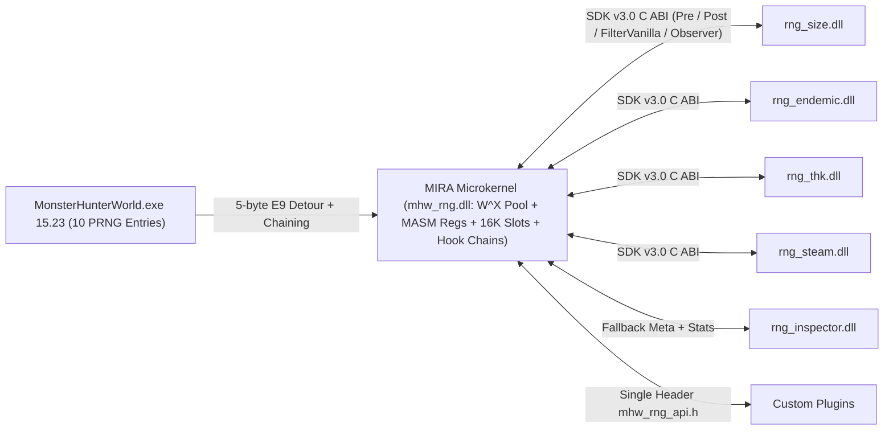

# MIRA

> **M**IRA **I**ntercepts **R**NG **A**PIs

《怪物猎人：世界 冰原》（Steam 15.23 / Build 15539686）随机数生成操纵框架

简体中文 | [English](README_EN.md)

---

MIRA（运行时模块 `nativePC\plugins\mhw_rng.dll`）是一个基于 **微内核与热重载插件架构** 的游戏内随机数观测、固定与按条件分流框架。玩家与研究者只需安装核心 DLL 与对应业务插件（通过 Stracker's Loader 加载），即可直接在游戏聊天栏使用 `$rng`（兼容 `$rng_<subcmd>`）指令实时控制怪物体型、环境生物尺寸、怪物 AI 行为决策与蒸汽机抽签，无需打开 Cheat Engine、重启游戏或修改 `.thk` 等游戏本体资源文件。

> [!NOTE]
> 本框架与配套官方插件面向单机练习、机制验证与逆向研究使用，请勿在公开多人集会或影响他人联机体验的环境中使用。

---

## 一、粗略原理与微内核能力

### 为什么要采用“微内核 + 条件分流槽”架构

在原版游戏中，怪物 AI、体型倍率、环境生物、蒸汽机洗牌乃至粒子特效和界面抖动共用了同一个全局 `MtRandom::sInstance`，并由多个工作线程并发推进。只要帧率或场上特效次数略有波动，整个随机序列就会偏移，单纯固定全局种子无法稳定复现目标结果。

MIRA 将底层钩子与随机流调度下沉为与具体游戏玩法解耦的微内核（`mhw_rng.dll`），上层所有游戏业务规则全部交由可独立编译、热插拔的子插件（`nativePC\plugins\mhw_rng\*.dll`）实现：



### 微内核提供的 RNG 操纵能力

1. **全量伪随机数入口拦截与上下文快照**
   - 拦截游戏 `.text` 段全部 10 处底层随机数入口：`MtRandom`（`nrand`、`ctor(seed)`、`ctor_default`、`srand`、`randUnitSphere`）、`mt19937`（`envelope_range`、`heap_init`、`heap_draw`）、`std::_Random_device` 与 `CRT_rand`。
   - 入口经 MASM x64 跳板捕获调用方的 8 个非易失通用寄存器（`RBX/RBP/RSI/RDI/R12..R15`）、栈返回地址槽与原始函数入参（如 `seed`、`minVal`/`maxVal`），供上层插件在不修改游戏代码的情况下识别当前怪物、物种、THK 节点或蒸汽机控制块。
   - Phase 1 预保留连续 **64 KB（`16 × 4 KB`）** 严格 W^X（`PAGE_EXECUTE_READ`）跳板池：第 0 页用于 10 处核心 RNG 钩子，第 1..15 页供 Phase 2 的 `sChat::DispatchChatEntry`、`sChat::move` 及可选 `D3DPresent` 使用；内置跨 Mod `E9` 跳转串联与 Phase 3（`+1.5s` / `+4.0s`）未串联覆盖自愈。

2. **按 `(CondID, CallSiteRVA)` 隔离的 16,384 复合条件槽**
   - 每个调用点可按条件编号 `CondID` 拆分为互不干扰的独立随机流（支持 Tombstone 槽位回收），同一场战斗中的不同怪物或不同条件彼此独立。
   - 支持五种槽模式：`MasterDerived`（按总种子、RVA 与条件号派生）、`CustomSeed`（独立 64 位种子）、`FixedValue`（固定原始 `uint32_t`）、`Sequence`（按序输出数组，支持 `Loop` / `HoldLast` / `FallbackDerived`，`> 8` 项动态分配可回收堆缓冲）与 `Bypass`（原版直通）。

3. **四态全局引擎切换与存档种子保护**
   - `selective`（Selective，默认推荐）：按需接管模式，仅对配置了槽规则或挂载了插件钩子的点位生效；其余未触碰的游戏调用点及存档持久化种子 100% 走原版 RNG。
   - `on`（Takeover）：全局确定性接管模式，所有玩法调用点按总种子派生；配合 `ProtectSaveSeeds = true`（默认开启）时自动保护猫饭/炼金/鉴定/赤龙觉醒等 31 处存档持久化种子推进器免被改写。
   - `observe`（ObserveOnly）：仅观测模式，全部抽取走原版实现并保持原版结果不变，同时继续维持计数器并触发带 `kMhwRngHookObserveOnly` 的只读观测回调。
   - `off`（Off）：关闭接管，直接跳转原版函数。

4. **`O(1)` 轮次重置与全表二进制快照**
   - `$rng reset` 通过递增全局 `Epoch` 以 `O(1)` 复杂度重置所有派生流并清零本轮统计。
   - `$rng save [name]` / `$rng restore [name]` / `$rng saves` 支持保存与恢复带 `'MRSS'` 魔数与 CRC32 校验的完整内存 RNG 状态快照。

5. **插件介入流水线**
   - 支持 Push 模式条件切换（`SetActiveCondition`）、同 RVA 最多 8 个回调按 `priority` 排序的 Pre/Post Hook 链、`FilterVanilla` 原版结果后置过滤/钳位、全局通配观测器、`sChat::move` 主线程异步聊天队列以及内核生命周期事件广播。

---

## 二、官方插件（支持热重载）

所有子插件放置于 `nativePC\plugins\mhw_rng\*.dll`。微内核加载时会先将其影拷贝至 `.hotload\` 临时目录再调用 `LoadLibrary`，游戏运行期间源 DLL 文件不被锁定。玩家或开发者在游戏聊天框输入 `$rng load <名>`、`$rng unload <名>` 或 `$rng reload [名]` 即可完成热加载、卸载与免重启更新。

| 插件 | 模块产物 | 挂钩点位 (RVA) | 核心功能与典型指令 | 独立仓库与文档 |
| :--- | :--- | :--- | :--- | :--- |
| **`size`** | `rng_size.dll` | `0x169BA15` | 支持冰原全 71 种大型怪物按 `MonsterID` 条件控制大小金；采用安全开区间 `[0x00000001U, 0xFFFFFF00U]` 避开零权重非法行，并可读取实时 `cSizeTable` 反算指定百分比（如 `$rng size furious_rajang min`、`$rng size rajang* exact 116`） | [mhw-rng-size](https://github.com/Miraboreasyu/mhw-rng-size) \| [技术文档](plugins/size/README.md) |
| **`endemic`** | `rng_endemic.dll` | `0x166CFE1` / `0x0672FBC` / `0x1669CB6` | 覆盖环境生物地图刷新与捕获抽签，通过调用栈过滤共享随机函数，支持小金/普通/大金档位、按 `ecXXX_YY` 物种分流以及实时查 `rAnimalSize` 反算倍率或厘米数（如 `$rng endemic max`、`$rng endemic ec059_02 exact 25.5cm`） | [mhw-rng-endemic](https://github.com/Miraboreasyu/mhw-rng-endemic) \| [技术文档](plugins/endemic/README.md) |
| **`thk`** | `rng_thk.dll` + `thk_presets\*.txt` | `0x1339C8C` | 通用 THK 随机节点探测、按怪物实例的决策与出招计数、计数门控、概率组合分枝、有序序列与热重读 `.txt` 预设；内置黑龙一阶段二足+四足全距离预设（怒前 `f=0` 与怒后 `f=4`，`$rng fatalis on` / `$rng thk probe on 91`） | [mhw-rng-thk](https://github.com/Miraboreasyu/mhw-rng-thk) \| [技术文档](plugins/thk/README.md) \| [预设语法指南](plugins/thk/PRESET_GUIDE.md) |
| **`steam`** | `rng_steam.dll`（`1.1.0`） | `0x066679A` / `0x06667BB` / `0x05CA0A2` | 在 `ObserveOnly` 与 `Takeover` 下实时解码蒸汽机三键顺序、红槽倍率与隐藏保底，支持可选固定按键顺序（`$rng steam lock` 默认锁 `awd`）；`verbose` 默认关闭，仅在未锁序时提示键位，`$rng steam verbose on` 后播报锁序与保底详情；同时作为 SDK v3.0 官方参考示例 | [mhw-rng-steam](https://github.com/Miraboreasyu/mhw-rng-steam) \| [技术文档](plugins/steam/README.md) |
| **`inspector`** | `rng_inspector.dll` | 无热路径 Hook | 提供 1,697 处静态调用点与 793 个外层函数区间的兜底词典、排行监控与多尺度换算锁定，可按需 `$rng unload inspector` 卸载以释放内存（常用：`$rng top`、`$rng dump`、`$rng find <kw>`、`$rng fix meal 0`） | [mhw-rng-inspector](https://github.com/Miraboreasyu/mhw-rng-inspector) \| [技术文档](plugins/inspector/README.md) |

### 安装与内核基础指令

1. **前置**：确保已安装 [Stracker's Loader](https://www.nexusmods.com/monsterhunterworld/mods/1982)。
2. **部署**：将构建产物或发布文件按如下结构放入游戏目录的 `nativePC\plugins\` 下：
   - `nativePC\plugins\mhw_rng.dll`
   - `nativePC\plugins\mhw_rng.ini`
   - `nativePC\plugins\mhw_rng\rng_size.dll`、`rng_endemic.dll`、`rng_thk.dll`、`rng_steam.dll`、`rng_inspector.dll`
   - `nativePC\plugins\mhw_rng\thk_presets\fatalis_p1_nasty.txt`
3. **验证就绪**：进入游戏后聊天框会自动显示 `[RNG] mhw_rng v3.0 已就绪（已载入 ... 个插件 | 模式:... | 输入 $rng help）`。

常用内核指令（可通过 `mhw_rng.ini` 中的 `ChatPrefix` 修改前缀）：

| 指令 | 说明 |
| :--- | :--- |
| `$rng` / `$rng status` | 查看引擎状态、当前总种子、轮次、已载入插件数与激活规则 |
| `$rng help` | 列出微内核指令及当前所有已加载插件注册的子指令 |
| `$rng selective` / `$rng on` / `$rng observe` / `$rng off` | 切换按需接管（默认）/ 全局接管 / 仅观测（原版结果）/ 关闭直通 |
| `$rng seed <u64>` / `$rng reset` | 切换 64 位总种子或按 `Epoch` 归零全部确定性随机流 |
| `$rng save [name]` / `$rng restore [name]` / `$rng saves` | 保存、恢复或列出内存中的全表二进制 RNG 状态快照 |
| `$rng plugins` / `load <name>` / `unload <name>` / `reload [name]` | 管理并免重启热重载子插件（无参数 `reload` 同时重读 `mhw_rng.ini`） |
| `$rng clearall` | 清空所有槽位规则并向已加载插件广播清理事件 |

---

## 三、Plugin SDK v3.0 与构建指南

MIRA 通过单头文件 [include/mhw_rng_api.h](include/mhw_rng_api.h) 向所有插件提供稳定的 C ABI（`kMhwRngApiVersion == 3`），**编译插件不需要链接任何 `.lib` 导入库**。

### 1. 插件导出约定与宿主能力

每个插件 DLL 仅需导出 3 个 C 函数：
- `const MhwRngPluginDescriptor* MhwRngPlugin_GetInfo()`：声明 `targetApiVersion = kMhwRngApiVersion`、全小写唯一 `shortName`、版本与简介。
- `bool MhwRngPlugin_Init(const MhwRngHostApi* host, MhwRngPluginId selfId)`：保存 `host` 与 `selfId`，注册钩子、命令或站点元数据。
- `void MhwRngPlugin_Shutdown()`（可选）：在宿主完成回调摘除、在途调用排空、命令与规则清理后执行自有资源释放。

`MhwRngHostApi` 提供的主要接口分组：

| 类别 | 主要接口 | 作用 |
| :--- | :--- | :--- |
| 全局状态 | `SetEngineMode` / `GetEngineMode` / `SetMasterSeed` / `ResetEpoch` | 切换四态引擎模式、读写总种子与全局轮次 |
| 条件与槽位规则 | `SetActiveCondition` / `SetCondMasterDerived` / `SetCondCustomSeed` / `SetCondFixedValue` / `SetCondSequence` / `SetCondBypass` / `ReleaseCondSlot` | Push 模式条件切换、按 `(rva, condId)` 写规则及回收 Tombstone 条件槽 |
| Hook 链与观测 | `RegisterSlotHook` / `RegisterSlotHookEx` / `RegisterGlobalObserver` / `RegisterLifecycleHook` | 按优先级挂载 Pre/Post/`FilterVanilla` 回调、全游戏通配观测器与生命周期事件监听 |
| 现场与封装展开 | `MhwRngDrawContext`（`callerRegs`、`origArg1/2`、`origMinVal/MaxVal`、`origReturnRva`）/ `RegisterTransparentWrapper` / `SetInstancePolicy` | 读取入口 8 个非易失寄存器与原入参、注册自定义栈帧展开与私有 `MtRandom` 策略 |
| 快照与状态恢复 | `GetCondSlotInfo` / `SnapshotActiveSlots` / `RestoreSlotState` / `CaptureStateBlob` / `RestoreStateBlob` | 读写单槽游标状态及 CRC32 校验二进制全表快照 |
| 聊天与元数据 | `RegisterSubcommand` / `RegisterSiteMeta` / `SetFallbackMetaResolver` / `ChatPrintAsync` / `ChatPrintfAsync` / `Log` | 统一挂载 `$rng <subcmd>`、自定义点位状态展示与跨线程主线程聊天队列输出 |

### 2. 最小可编译插件示例

完整示范了 `RegisterSlotHookEx`、`ObserveOnly` 穿透、MASM 寄存器读取（`rbx`/`rdi`）、异步聊天投递与生命周期联动的示例源码位于 [plugins/steam/steam_plugin.cpp](plugins/steam/steam_plugin.cpp)。最小骨架示例：

```cpp
#include "mhw_rng_api.h"

namespace {
const MhwRngHostApi* g_host   = nullptr;
MhwRngPluginId       g_selfId = 0;

constexpr std::uint32_t kRvaMealTrigger = 0x0F99246U; // 猫饭技能发动判定 (u32 % 100)

void __fastcall Cmd_Meal(int argc, const char* const* argv, const char*, void*) {
    if (argc >= 1 && argv[0][0] == '0') {
        g_host->ClearSlotAllConditions(kRvaMealTrigger);
        g_host->ChatPrint(u8"[meal] 已恢复默认猫饭发动概率");
        return;
    }
    g_host->SetCondFixedValue(g_selfId, kRvaMealTrigger, 0U, 0U);
    g_host->ChatPrint(u8"[meal] 已将猫饭判定余数固定为 0");
}

const MhwRngPluginDescriptor kDesc = {
    kMhwRngApiVersion, "meal", u8"猫饭技能示例插件", "1.0.0", u8"固定猫饭技能发动判定"
};
} // namespace

MHW_RNG_PLUGIN_EXPORT const MhwRngPluginDescriptor* MhwRngPlugin_GetInfo() { return &kDesc; }

MHW_RNG_PLUGIN_EXPORT bool MhwRngPlugin_Init(const MhwRngHostApi* host, MhwRngPluginId selfId) {
    if (!host || host->apiVersion != kMhwRngApiVersion) return false;
    g_host   = host;
    g_selfId = selfId;
    host->RegisterSiteMeta(selfId, kRvaMealTrigger, "meal.trigger", u8"猫饭技能发动判定", nullptr, nullptr);
    host->RegisterSubcommand(selfId, "meal", "$rng meal [1|0]", u8"设置或恢复猫饭技能判定", &Cmd_Meal, nullptr);
    return true;
}

MHW_RNG_PLUGIN_EXPORT void MhwRngPlugin_Shutdown() { g_host = nullptr; g_selfId = 0; }
```

在 Visual Studio x64 命令行环境下单命令即可编译为 DLL：

```bat
cl.exe /nologo /std:c++17 /O2 /EHsc /MT /utf-8 /I "include" rng_meal.cpp /LD /Fe:"nativePC\plugins\mhw_rng\rng_meal.dll"
```

游戏内聊天框输入 `$rng load meal` 首次加载；后续重编覆盖后输入 `$rng reload meal` 即可完成热更新。

### 3. 从源码构建与脱机回归测试

```bash
git clone --recursive https://github.com/Miraboreasyu/mhw-rng.git
```

- **全量构建**：执行 [`build.bat`](build.bat)，同步全部子模块 SDK 头文件并编译产出 `build\mhw_rng.dll`、`build\mhw_rng\rng_*.dll` 与 `build\mhw_rng\thk_presets\fatalis_p1_nasty.txt`。
- **脱机回归测试**：执行 [`run_tests.bat`](run_tests.bat)（需通过参数或环境变量 `MHW_TEXT_BIN` 指定解壳后的 15.23 `.text` 段文件 `text_1523.bin`），在真实游戏机器码上验证 10 处 W^X Hook、8 线程隔离、全部官方插件与 SDK v3.0 接口。

### 4. 技术文档导航

- 核心框架原理与 SDK 详细规范：[docs/ARCHITECTURE.md](docs/ARCHITECTURE.md)
- SDK 头文件与配置文件：[include/mhw_rng_api.h](include/mhw_rng_api.h) | [mhw_rng.ini](mhw_rng.ini)
- 官方插件技术文档：[size](plugins/size/README.md) | [endemic](plugins/endemic/README.md) | [thk](plugins/thk/README.md)（[预设编写指南](plugins/thk/PRESET_GUIDE.md)）| [steam](plugins/steam/README.md) | [inspector](plugins/inspector/README.md)
