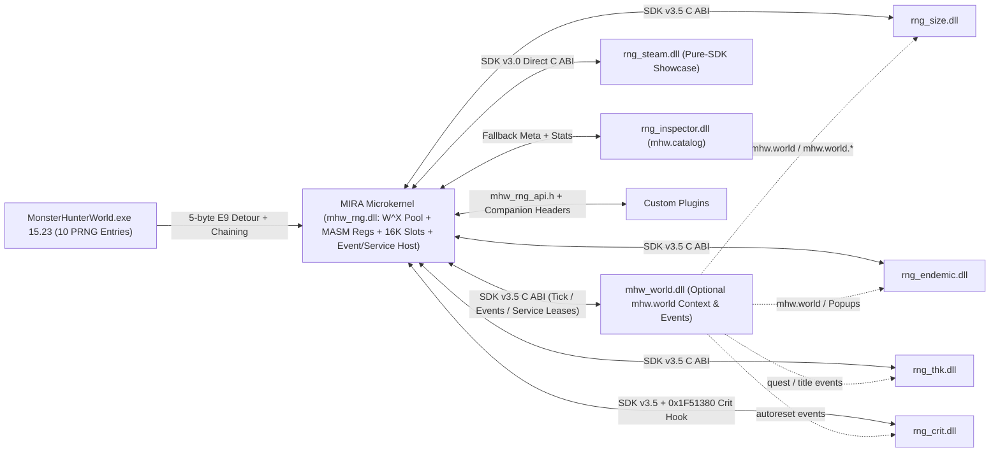

# MIRA

> **M**IRA **I**ntercepts **R**NG **A**PIs

RNG Manipulation Framework for Monster Hunter: World – Iceborne (Steam 15.23 / Build 15539686)

[简体中文](README.md) | English

---

MIRA (runtime core: `nativePC\plugins\mhw_rng.dll`) is an in-game RNG observation, override, and conditional routing framework built on a **microkernel + hot-reloadable plugin architecture**. Loaded via Stracker's Loader, it lets players and researchers control monster crown sizes, endemic life scales, monster THK AI decisions, Steamworks draws, and attack critical hits directly from in-game chat (`$rng`, also accepting `$rng_<subcmd>`), without Cheat Engine, game restarts, or modifying `.thk` or asset files.

> [!NOTE]
> This framework and its official plugins are intended for single-player practice, mechanics testing, and reverse-engineering research. Do not use them in public multiplayer lobbies.

---

## 1. How It Works: Microkernel & RNG Capabilities

### Why a Microkernel + Composite Slot Table

In vanilla MHW:I, monster AI, size rolls, endemic life spawns, Steamworks shuffles, particles, and UI effects all share the single global `MtRandom::sInstance` across multiple worker threads. Any variation in framerate or visual effects shifts the shared PRNG state, making a raw global seed insufficient for reproducible behavior.

MIRA separates low-level hook installation, slot state management, and plugin hosting into a domain-agnostic microkernel (`mhw_rng.dll`), while keeping all game-specific memory parsing and rules inside hot-reloadable plugin DLLs (`nativePC\plugins\mhw_rng\*.dll`):



### RNG Manipulation Capabilities Provided by the Microkernel

1. **10-Entry PRNG Interception & Register Capture**
   - Hooks all 10 PRNG entries in the 15.23 `.text` segment: `MtRandom` (`nrand`, `ctor(seed)`, `ctor_default`, `srand`, `randUnitSphere`), `mt19937` (`envelope_range`, `heap_init`, `heap_draw`), `std::_Random_device`, and `CRT_rand`.
   - MASM x64 entry thunks preserve all 8 non-volatile caller GPRs (`RBX/RBP/RSI/RDI/R12..R15`), the caller stack return slot, and original call arguments (`seed`, `minVal`/`maxVal`, etc.), enabling plugins to inspect active `Monster*`, species entries, THK states, or `cSteamControl*` without extra hooks.
   - Pre-reserves a contiguous **64 KB (`16 × 4 KB`)** strict W^X (`PAGE_EXECUTE_READ`) trampoline pool in Phase 1: Page 0 holds the 10 core RNG detours, and Pages 1..15 serve Phase 2 standalone detours (`sChat::DispatchChatEntry`, `sChat::move`, optional `D3DPresent`), with cross-mod `E9` chaining and Phase 3 (`+1.5s` / `+4.0s`) unchained-overwrite self-healing.

2. **16,384-Slot `(CondID, CallSiteRVA)` Stream Isolation**
   - Isolates deterministic streams per call site and plugin-defined `CondID` in a tombstone-capable hash table so unrelated monsters or conditions never perturb each other.
   - Supports 5 slot modes: `MasterDerived`, `CustomSeed` (64-bit per-slot seed), `FixedValue` (constant `uint32_t`), `Sequence` (`Loop` / `HoldLast` / `FallbackDerived`, with reclaimable heap storage for `> 8` items), and `Bypass` (original vanilla function).

3. **4-State Global Engine Mode & Save-Seed Protection**
   - `selective` (`Selective`, default): intercepts only slots with active overrides or plugin hooks; all untouched gameplay sites and save-persisted PRNG seeds run 100% vanilla.
   - `on` (`Takeover`): full deterministic takeover across gameplay call sites; with `ProtectSaveSeeds = true` (default), 31 save-persisted PRNG stepper RVAs (canteen/melder/appraisal/Safi awakening/save salt) stay untouched unless explicitly overridden.
   - `observe` (`ObserveOnly`): executes vanilla RNG for 100% unmodified outputs while maintaining call counters and firing `kMhwRngHookObserveOnly` / global observers.
   - `off` (`Off`): directly calls original vanilla functions without entering slot lookup.

4. **`O(1)` Epoch Reset & Binary State Snapshots**
   - `$rng reset` increments the global `Epoch` to rewind all derived streams and zero per-round counters in `O(1)`.
   - `$rng save [name]` / `$rng restore [name]` / `$rng saves` capture and restore full-table binary snapshots verified with `'MRSS'` magic and CRC32.

5. **Plugin Arbitration Pipeline & In-Game Terminal**
   - Push-mode condition switching (`SetActiveCondition`), prioritized multi-plugin Hook chains (up to 8 hooks per RVA), `FilterVanilla` / `FilterSlot` post-draw & slot-filtered hooks, global wildcard observers, main-thread async chat queueing via `sChat::move`, lifecycle broadcasts, standardized `SelectText` / `Register*I18n` localization, and `RegisterSubcommandCompleter` multi-level completion.
   - Built-in D3D11/D3D12 (SDR / HDR10 / scRGB) **in-game overlay terminal window** (default hotkey `` ` `` / `~`) featuring UTF-8 `libreadline` editing, Chinese/CJK IME composition & inline candidate strip rendering, history + `Ctrl+R`, dynamic multi-level plugin `Tab` completion, mouse drag / double-click word / triple-click line selection & clipboard copy, and default-muted native chat echo (`$rng chat on|off`).

---

## 2. Official Plugins (Hot-Reloadable)

Plugins placed in `nativePC\plugins\mhw_rng\*.dll` are loaded through shadow copies inside `.hotload\` before `LoadLibrary`. Source DLL files on disk remain unlocked while the game is running, allowing you to recompile and run `$rng reload <name>` (or `$rng load` / `$rng unload`) without restarting MHW.

| Plugin | Output DLL | Hook RVA(s) | Capabilities & Example Commands | Repo & Docs |
| :--- | :--- | :--- | :--- | :--- |
| **`size`** | `rng_size.dll` | `0x169BA15` | Per-`MonsterID` crown and size control for all 71 large monsters; safe open interval `[0x00000001U, 0xFFFFFF00U]` skips zero-weight disabled rows; live `cSizeTable` inverse solving (`exact`). Examples: `$rng size furious_rajang min`, `$rng size rajang* exact 116` | [mhw-rng-size](https://github.com/Miraboreasyu/mhw-rng-size) \| [README](plugins/size/README.md) |
| **`endemic`** | `rng_endemic.dll` | `0x166CFE1` / `0x0672FBC` / `0x1669CB6` / `0x1A4ACED` / `0x0271F25` / `0x166D12E` / `0x1A44FCC` | Covers both map spawn and capture size rolls, filters shared float helpers by caller return address, supports crown tiers, per-`ecXXX_YY` rules, and live `rAnimalSize` scale/cm solving. Also forces or blocks rare endemic life, extra Great-size fish and regional rare Moly spawns via pure RNG (vanilla weather/time/Guiding Lands level gates still apply), with in-game Simplified Chinese / English name selectors. Examples: `$rng endemic max`, `$rng endemic ec059_02 exact 25.5cm`, `$rng endemic rare wintermoon_nettle on` | [mhw-rng-endemic](https://github.com/Miraboreasyu/mhw-rng-endemic) \| [README](plugins/endemic/README.md) |
| **`thk`** | `rng_thk.dll` + `thk_presets\*.txt` | `0x1339C8C` | Pure-RNG THK AI node probing, per-monster move/decision counters, count-gated rules, weighted branch splits, move sequences, and hot-reloadable `.txt` presets; includes Fatalis Phase 1 bipedal + quadruped preset (`f=0,4`). Examples: `$rng fatalis on`, `$rng thk probe on 91` | [mhw-rng-thk](https://github.com/Miraboreasyu/mhw-rng-thk) \| [README](plugins/thk/README.md) \| [PRESET_GUIDE](plugins/thk/PRESET_GUIDE.md) |
| **`steam`** | `rng_steam.dll` (`1.3.0`) | `0x066679A` / `0x06667BB` / `0x05CA0A2` | Real-time Steamworks 3-key order, red round, and hidden-pity decoding in both `ObserveOnly` and `Takeover`; optional sequence lock (`awd`); intentionally uses **only** `mhw_rng_api.h` as the pure direct-microkernel showcase | [mhw-rng-steam](https://github.com/Miraboreasyu/mhw-rng-steam) \| [README](plugins/steam/README.md) |
| **`crit`** | `rng_crit.dll` (`1.0.0`) | `0x01F606D6` (+ plugin `0x1F51380`) | Override affinity `-100..100%` or follow live panel+WEX (`auto`); Pure Random (`CondID 1`), exact `m:n` / custom `seq`, `mv_bank`, `mv_tier`, `bag`, and `prd`, with quest/title telemetry auto-reset (`$rng crit autoreset on\|off`) | [mhw-rng-crit](https://github.com/Miraboreasyu/mhw-rng-crit) \| [README](plugins/crit/README.md) |
| **`inspector`** | `rng_inspector.dll` | None (zero hot-path overhead) | Bilingual static fallback dictionary of 1,697 sites / 793 functions + `"mhw.catalog"` lookup service, live dump/rank, `.pdata` multi-hop stack & `XMM6/7` tracer (`$rng trace`), and scale-aware value injection (`$rng top`, `$rng dump`, `$rng find <kw>`, `$rng fix meal 0`) | [mhw-rng-inspector](https://github.com/Miraboreasyu/mhw-rng-inspector) \| [README](plugins/inspector/README.md) |
| **`world`** *(built-in)* | `mhw_world.dll` | Main-thread tick poll | Shared 15.23 world state service `"mhw.world"`, scene/quest/stage/hour/weather event bus (`"mhw.world.*"`), and main-thread HUD popup queue (`$rng world [status\|events on\|off\|popup]`); gameplay plugins degrade gracefully if unloaded | [world_plugin.cpp](world/world_plugin.cpp) |

### Installation & Core Commands

1. **Prerequisite**: Install [Stracker's Loader](https://www.nexusmods.com/monsterhunterworld/mods/1982).
2. **Deploy files** under the game directory:
   - **(If using SharpPluginLoader)** Game root `winmm.dll` from [patches/spl/winmm.dll](patches/spl/winmm.dll) (minimal WndProc re-subclass fix preventing post-return-to-title input/IME lockups when SPL coexists with overlay mods; see [SPL patch notes](patches/spl/README.md))
   - `nativePC\plugins\mhw_rng.dll`
   - `nativePC\plugins\mhw_rng.ini`
   - `nativePC\plugins\mhw_rng\mhw_world.dll`, `rng_size.dll`, `rng_endemic.dll`, `rng_thk.dll`, `rng_steam.dll`, `rng_crit.dll`, `rng_inspector.dll`
   - `nativePC\plugins\mhw_rng\thk_presets\fatalis_p1_nasty.txt`
3. **Verify**: Press `` ` `` / `~` in-game to open the overlay terminal (no `$rng` prefix needed inside it), or check the startup notice in chat.

Core built-in commands (prefix configurable via `ChatPrefix` in [mhw_rng.ini](mhw_rng.ini)):

| Command | Description |
| :--- | :--- |
| `$rng` / `$rng status` | Show engine mode, active seed, epoch, loaded plugin count, and active rules |
| `$rng help [cmd\|plugin]` | List core commands and grouped plugin subcommands, or show detailed usage |
| `$rng selective` / `$rng on` / `$rng observe` / `$rng off` | Switch between Selective (default), full Takeover, ObserveOnly (vanilla RNG), and Off |
| `$rng seed <u64>` / `$rng reset` | Set 64-bit master seed or reset epoch counters/streams |
| `$rng save [name]` / `$rng restore [name]` / `$rng saves` | Capture, restore, or list in-memory RNG state snapshots |
| `$rng lang [zh\|en\|...]` / `$rng chat [on\|off]` | Switch display language live (broadcast to plugins) or toggle native chat echo |
| `$rng exec <file> [quiet]` | Execute batch commands from a script file (supports `AutoExec` in `mhw_rng.ini`) |
| `$rng plugins` / `load <name>` / `unload <name>` / `reload [name\|ini]` | Inspect, load, unload, or hot-reload plugins (bare `reload` preserves runtime mode/seed unless INI changed; `reload ini` forces INI values) |
| `$rng rawfix` / `rawseed` / `rawseq` / `rawbypass` / `rawclear` | Directly control raw RVAs without any plugin loaded |
| `$rng clearall` | Clear all slot overrides and broadcast `kMhwRngEventClearAllRules` to plugins |

---

## 3. Plugin SDK v3.5 & Companion SDK Build Guide

MIRA exposes a single-header C ABI via [include/mhw_rng_api.h](include/mhw_rng_api.h) (`kMhwRngApiVersion == 3`, backwards-compatible through v3.5) alongside optional header-only Companion SDK headers (`mhw_rng_math.h`, `mhw_1523_world.h`, `mhw_world_api.h`, `mhw_catalog_api.h`), requiring **no `.lib` import library** to compile plugins.

### 1. Exports & `MhwRngHostApi` Overview

Each plugin DLL exports up to 3 C entry points:
- `const MhwRngPluginDescriptor* MhwRngPlugin_GetInfo()`
- `bool MhwRngPlugin_Init(const MhwRngHostApi* host, MhwRngPluginId selfId)`
- `void MhwRngPlugin_Shutdown()` *(optional; invoked after hooks, in-flight calls, subcommands, and slot rules are cleaned up)*

Key `MhwRngHostApi` capabilities:

| Group | Key APIs | Purpose |
| :--- | :--- | :--- |
| Global Control | `SetEngineMode` / `GetEngineMode` / `SetMasterSeed` / `ResetEpoch` | Control 4-state engine mode, seed, and epoch |
| Conditions & Slots | `SetActiveCondition` / `SetCondMasterDerived` / `SetCondCustomSeed` / `SetCondFixedValue` / `SetCondSequence` / `SetCondBypass` / `ReleaseCondSlot` | Push condition routing, per-`(rva, condId)` slot configuration, and tombstone slot reclamation |
| Hooks & Observers | `RegisterSlotHook` / `RegisterSlotHookEx` (`FilterVanilla` / `FilterSlot`) / `RegisterGlobalObserver` / `RegisterLifecycleHook` | Prioritized Pre/Post/filter hook chains, wildcard observers, and lifecycle notifications |
| Context, Unwind & Wrappers | `MhwRngDrawContext` (`callerRegs`, `xmm6/7`, `origArg*`, `origReturnRva`) / `CaptureCallerRvas` / `RegisterTransparentWrapper` / `SetInstancePolicy` | Read preserved entry GPRs & `XMM6/7`, SEH `.pdata` caller stack unwinding, custom wrapper unwrapping, and private `MtRandom` policy |
| Snapshots | `GetCondSlotInfo` / `SnapshotActiveSlots` / `RestoreSlotState` / `CaptureStateBlob` / `RestoreStateBlob` | Inspect slot state or capture/restore CRC32-checked binary blobs |
| Chat, i18n & Completion | `RegisterSubcommand` / `RegisterSubcommandCompleter` / `SelectText` / `Register*I18n` / `GetLanguage` / `ExecuteCommand` / `RegisterSiteMeta` / `SetFallbackMetaResolver` / `ChatPrintAsync` | Register `$rng <subcmd>` handlers, multi-level Tab completion, `active->en->zh` localization, command routing, and thread-safe async chat notices |
| Ticks, Events & Services | `RegisterMainThreadTick` / `SubscribeEvent` / `EmitEvent` / `RegisterService` / `MhwRngServiceGuard<T>` | Frame-safe main-thread polling, exact/`prefix.*`/`*` event bus, and hot-reload-safe service leases with atomic drain |

### 2. Minimal Plugin Example

For a complete SDK v3.0 reference covering `RegisterSlotHookEx`, `ObserveOnly`, MASM register reads (`rbx`/`rdi`), async chat notices, and lifecycle hooks, see [plugins/steam/steam_plugin.cpp](plugins/steam/steam_plugin.cpp). Minimal starter skeleton:

```cpp
#include "mhw_rng_api.h"

namespace {
const MhwRngHostApi* g_host   = nullptr;
MhwRngPluginId       g_selfId = 0;

constexpr std::uint32_t kRvaMealTrigger = 0x0F99246U; // Felyne food skill activation (u32 % 100)

void __fastcall Cmd_Meal(int argc, const char* const* argv, const char*, void*) {
    if (argc >= 1 && argv[0][0] == '0') {
        g_host->ClearSlotAllConditions(kRvaMealTrigger);
        g_host->ChatPrint(u8"[meal] Restored default food skill RNG");
        return;
    }
    g_host->SetCondFixedValue(g_selfId, kRvaMealTrigger, 0U, 0U);
    g_host->ChatPrint(u8"[meal] Fixed food skill roll remainder to 0");
}

const MhwRngPluginDescriptor kDesc = {
    kMhwRngApiVersion, "meal", u8"Meal Trigger Sample Plugin", "1.0.0", u8"Fixed food skill activation"
};
} // namespace

MHW_RNG_PLUGIN_EXPORT const MhwRngPluginDescriptor* MhwRngPlugin_GetInfo() { return &kDesc; }

MHW_RNG_PLUGIN_EXPORT bool MhwRngPlugin_Init(const MhwRngHostApi* host, MhwRngPluginId selfId) {
    if (!host || host->apiVersion != kMhwRngApiVersion) return false;
    g_host   = host;
    g_selfId = selfId;
    host->RegisterSiteMeta(selfId, kRvaMealTrigger, "meal.trigger", u8"Food skill roll", nullptr, nullptr);
    host->RegisterSubcommand(selfId, "meal", "$rng meal [1|0]", u8"Fix or restore food skill roll", &Cmd_Meal, nullptr);
    return true;
}

MHW_RNG_PLUGIN_EXPORT void MhwRngPlugin_Shutdown() { g_host = nullptr; g_selfId = 0; }
```

Compile in an MSVC x64 developer shell:

```bat
cl.exe /nologo /std:c++17 /O2 /EHsc /MT /utf-8 /I "include" rng_meal.cpp /LD /Fe:"nativePC\plugins\mhw_rng\rng_meal.dll"
```

Load in-game via `$rng load meal`, then rebuild and run `$rng reload meal` for iterative updates.

### 3. Build & Offline Regression Suite

```bash
git clone --recursive https://github.com/Miraboreasyu/mhw-rng.git
```

- **Build all modules**: run [`build.bat`](build.bat) to sync plugin SDK headers and build `build\mhw_rng.dll`, `build\mhw_rng\mhw_world.dll`, `build\mhw_rng\rng_*.dll`, and `build\mhw_rng\thk_presets\fatalis_p1_nasty.txt`.
- **Run offline tests**: run [`run_tests.bat`](run_tests.bat) (requires an unpacked 15.23 `.text` dump `text_1523.bin` via CLI argument or `MHW_TEXT_BIN`) to exercise all 10 W^X hooks, 8-thread isolation, `mhw_world.dll`, all 6 official plugins, and **Tests 1–25** (SDK v3.5) against real machine code.
- **Package release zip**: run `python tools/package_release.py --out <zip_path>` (or `--check` to validate) to build a clean release archive bundling the patched `winmm.dll` ([patches/spl/winmm.dll](patches/spl/winmm.dll)) with the 10 runtime `nativePC\plugins\...` files (11 total).

### 4. Documentation Index

- AI Harness Entrypoint: [AGENTS.md](AGENTS.md)
- Core Architecture & SDK Specification: [docs/ARCHITECTURE.md](docs/ARCHITECTURE.md)
- Standalone Plugin Developer Guide: [docs/PLUGIN_DEV_GUIDE.md](docs/PLUGIN_DEV_GUIDE.md) | Maintenance & QA Runbook: [docs/MAINTENANCE_AND_TESTING.md](docs/MAINTENANCE_AND_TESTING.md)
- Public Header, Config & SPL Patch: [include/mhw_rng_api.h](include/mhw_rng_api.h) | [mhw_rng.ini](mhw_rng.ini) | [SPL Patch Notes](patches/spl/README.md)
- Official Plugin Docs: [size](plugins/size/README.md) | [endemic](plugins/endemic/README.md) | [thk](plugins/thk/README.md) ([Preset Guide](plugins/thk/PRESET_GUIDE.md)) | [steam](plugins/steam/README.md) | [crit](plugins/crit/README.md) | [inspector](plugins/inspector/README.md)
