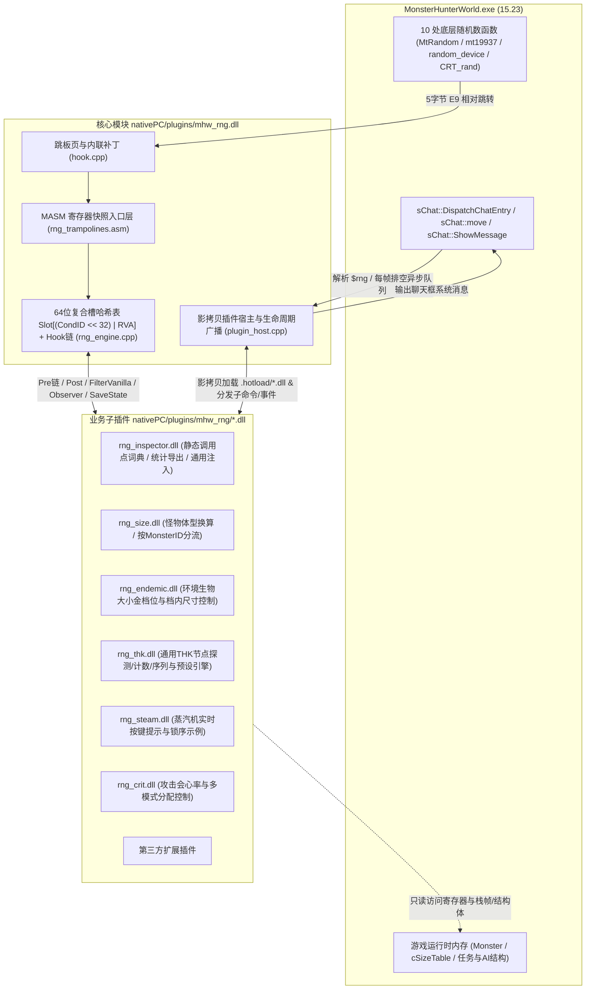
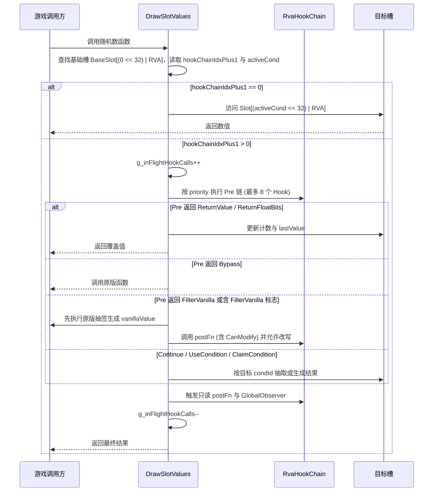

# `mhw_rng` 核心框架与插件 SDK（v3.4）技术文档

本文档说明 `mhw_rng` 随机数接管框架的职责划分、底层 Hook 点位、MASM 寄存器现场捕获层、复合条件槽数据结构、多插件 Hook 链与后置过滤机制、插件热重载流程以及插件 SDK（`kMhwRngApiVersion == 3`，向后兼容至 v3.4 扩展）接口规范。目标客户端版本为《怪物猎人：世界 冰原》Steam 15.23（Build 15539686，默认镜像基址 `0x140000000`）。

> [!NOTE]
> **职责边界与延伸阅读**
> 核心模块 [mhw_rng.dll](../src/dllmain.cpp) 仅负责底层随机数入口拦截、`(CondID, CallSiteRVA)` 槽位状态维护、插件生命周期管理与 `$rng` 聊天命令分发，不包含怪物 ID、数值换算公式或调用点词典等具体游戏业务逻辑。业务相关的内存读取、条件判断与命令扩展由 `nativePC\plugins\mhw_rng\*.dll` 下的子插件实现。
> - AI Harness / 新手接入入口：[AGENTS.md](../AGENTS.md)
> - 独立第三方插件开发手册：[PLUGIN_DEV_GUIDE.md](PLUGIN_DEV_GUIDE.md)
> - 内核维护、控制台/IME 与回归测试手册：[MAINTENANCE_AND_TESTING.md](MAINTENANCE_AND_TESTING.md)

---

## 一、模块拓扑与目录结构



### 运行时文件与源码对照

| 组件 | 游戏目录部署路径 | 对应源码 | 说明 |
| :--- | :--- | :--- | :--- |
| 核心模块 | `nativePC\plugins\mhw_rng.dll` | [dllmain.cpp](../src/dllmain.cpp)、[console_core.cpp](../src/console_core.cpp)、[console_overlay.cpp](../src/console_overlay.cpp)、[rng_trampolines.asm](../src/rng_trampolines.asm)、[rng_engine.cpp](../src/rng_engine.cpp)、[plugin_host.cpp](../src/plugin_host.cpp)、[hook.cpp](../src/hook.cpp) | 底层 Hook、游戏内终端窗口 (DX11/DX12/HDR + Readline + Tab 补全)、MASM 寄存器捕获、复合槽表、插件宿主 |
| 配置文件 | `nativePC\plugins\mhw_rng.ini` | [mhw_rng.ini](../mhw_rng.ini)、[log_config.cpp](../src/log_config.cpp) | 启动模式 `BootMode`、存档种子保护 `ProtectSaveSeeds`、初始 `MasterSeed`、自动加载插件开关、按地址配置的 `[SlotOverrides]` |
| 热加载缓存目录 | `nativePC\plugins\mhw_rng\.hotload\` | [plugin_host.cpp](../src/plugin_host.cpp#L278-L295) | 运行时自动创建的隐藏目录，存放影拷贝后的临时 DLL |
| 插件 SDK 头文件 | *(仅编译期依赖，无需链接 `.lib`)* | [mhw_rng_api.h](../include/mhw_rng_api.h) | C ABI 数据结构、`MhwRngHostApi` 函数指针表与导出约定 |
| 官方插件：`inspector` | `nativePC\plugins\mhw_rng\rng_inspector.dll` | [inspector_plugin.cpp](https://github.com/Miraboreasyu/mhw-rng-inspector/blob/main/inspector_plugin.cpp) | 详见《`rng_inspector` 插件技术文档》([README.md](https://github.com/Miraboreasyu/mhw-rng-inspector/blob/main/README.md)) |
| 官方插件：`size` | `nativePC\plugins\mhw_rng\rng_size.dll` | [size_plugin.cpp](https://github.com/Miraboreasyu/mhw-rng-size/blob/main/size_plugin.cpp) | 详见《`rng_size` 插件技术文档》([README.md](https://github.com/Miraboreasyu/mhw-rng-size/blob/main/README.md)) |
| 官方插件：`endemic` | `nativePC\plugins\mhw_rng\rng_endemic.dll` | [endemic_plugin.cpp](https://github.com/Miraboreasyu/mhw-rng-endemic/blob/main/endemic_plugin.cpp) | 详见《`rng_endemic` 插件技术文档》([README.md](https://github.com/Miraboreasyu/mhw-rng-endemic/blob/main/README.md)) |
| 官方插件：`thk` | `nativePC\plugins\mhw_rng\rng_thk.dll` + `thk_presets\*.txt` | [thk_plugin.cpp](https://github.com/Miraboreasyu/mhw-rng-thk/blob/main/thk_plugin.cpp) | 详见《`rng_thk` 插件技术文档》([README.md](https://github.com/Miraboreasyu/mhw-rng-thk/blob/main/README.md)) |
| 官方插件：`steam` | `nativePC\plugins\mhw_rng\rng_steam.dll` | [steam_plugin.cpp](https://github.com/Miraboreasyu/mhw-rng-steam/blob/main/steam_plugin.cpp) | 详见《`rng_steam` 插件技术文档》([README.md](https://github.com/Miraboreasyu/mhw-rng-steam/blob/main/README.md)) |
| 官方插件：`crit` | `nativePC\plugins\mhw_rng\rng_crit.dll` | [crit_plugin.cpp](https://github.com/Miraboreasyu/mhw-rng-crit/blob/main/crit_plugin.cpp) | 详见《`rng_crit` 插件技术文档》([README.md](https://github.com/Miraboreasyu/mhw-rng-crit/blob/main/README.md)) |

---

## 二、底层随机数函数拦截

### 1. 拦截入口列表
对 15.23 版本 `.text` 段（48.3 MB）的静态分析表明，游戏内不存在内联展开的 Xorshift128 步进代码，也不包含 `rdrand` / `rdseed` 指令。全部伪随机数生成汇聚于以下 10 个函数入口（定义见 [mhw_addresses.h](../src/mhw_addresses.h)）：

| 序号 | RVA | 符号 / 用途 | 备份指令长度 | 接管行为 |
| :-: | :--- | :--- | :-: | :--- |
| 1 | `0x2174E30` | `MtRandom::nrand(this)` | 6 B | 主抽取入口（共 747 个外层调用函数），区分全局单例 `sInstance`（`0x143FDEBD8`）与局部实例 |
| 2 | `0x2174CE0` | `MtRandom::ctor(this, seed)` | 6 B | 接管私有 `MtRandom` 实例的带种子初始化 |
| 3 | `0x2174D50` | `MtRandom::ctor_default(this)` | 8 B | 接管私有 `MtRandom` 实例的默认构造 |
| 4 | `0x2174DC0` | `MtRandom::srand(this, seed)` | 6 B | 接管状态重置；忽略外部对全局 `sInstance` 的重设请求 |
| 5 | `0x2174E60` | `MtRandom::randUnitSphere(this, out3)` | 6 B | 从当前槽位连续抽取 2 个 `uint32_t`，按原版浮点系数生成单位球面三维向量 |
| 6 | `0x273D420` | `std::_Random_device()` | 9 B | 接管 `rand_s` 外部熵调用（用于集会区域列表随机排序等） |
| 7 | `0x27D3E60` | `mt19937_envelope_range` | 13 B | 接管线程局部 `mt19937` 的区间浮点数生成 |
| 8 | `0x2A74400` | `mt19937_heap_init` | 5 B | 替换 `time64 ^ clock` 初始种子为槽位派生值 |
| 9 | `0x2A744B0` | `mt19937_heap_draw` | 6 B | 接管堆上 `mt19937` 实例的整数抽取 |
| 10 | `0x2C58034` | `CRT_rand()` | 9 B | 接管 MSVC CRT `rand()`（备份头部 `+4` 处的 `E8 rel32` 由跳板重算相对偏移） |

### 2. 调用点 RVA 归一化规则、寄存器捕获与通用栈回溯
- **MASM x64 入口现场捕获**：10 个底层钩子统一经 [rng_trampolines.asm](../src/rng_trampolines.asm) 进入 C++，在动用非易失寄存器前保存调用方 `RBX/RBP/RSI/RDI/R12..R15`、入口 `callerRsp`（与 `returnAddrSlot` 一致）、`callerRip` 以及非易失浮点寄存器 `XMM6/XMM7`（携带 `kMhwRngDrawFlagHasXmmRegs` 标志）到 `MhwRngCallerRegs`，并向 `MhwRngDrawContext` 透传原函数入参（`ctor(seed)` / `srand(seed)` / `mt19937_heap_init(seed)` 的 `origArg1` 以及 `mt19937_envelope_range` 的 `origMinVal`/`origMaxVal`）。
- **`.pdata` 通用多跳栈回溯**：`MhwRngHostApi::CaptureCallerRvas(ctx, outRvas, maxDepth)`（安全包装 `MhwRng_HostCaptureCallerRvas` 与 C 导出 `MhwRng_CaptureCallerRvas`）在 SEH 保护与零堆分配下基于 `RtlLookupFunctionEntry` + `RtlVirtualUnwind`（遇到未含 `.pdata` 的自定义 wrapper 时协同 `RegisterTransparentWrapper` 帧深表）按序收集主模块调用链 RVA，突破固定 2 跳限制。
- **动态透明包装展开**：在 `ComputeCallSiteRva`（[rng_engine.cpp](../src/rng_engine.cpp)）中内置 8 处透明包装（`0x04F71BF`、`0x2396F02`、`0x2396F2D`、`0x197D6A2`、`0x197D6B5`、`0x0672FBC`、`0x02CAB1E`、`0x02CD9D1`），支持插件通过 `RegisterTransparentWrapper` 扩展自定义帧深并做最多 2 层展开，展开前的原始返回地址保存在 `ctx->origReturnRva`。
- **`CALL` 指令地址对齐**：`NormalizeUserSiteAddress` 支持直接传入虚拟地址或 RVA；若传入地址处是目标为上述 10 个入口之一的 5 字节 `E8 rel32` 指令，则自动 `+5` 转换为对应的返回地址 RVA。
- **局部 `MtRandom` / `mt19937_heap` 实例策略**：内核维护 512 项实例策略表，并在 `SetInstancePolicy` 中提供 `Auto` / `FollowOwnState` / `ForceSlotControl` 三种接管策略；未显式指定时按本轮（`Epoch`）内是否由构造/初始化点指定过自定义种子自动判别。

### 3. 跳板内存池、链式 Hook 与三阶段启动
[hook.cpp](../src/hook.cpp) 的 `InitArena` 在第一阶段即在主程序镜像 `±2 GB` 范围内预保留一块 **64 KB（16 × 4 KB）** 连续虚拟地址空间，用于严格 W^X 跳板生成：
1. **第 0 页（4 KB 核心跳板页）**：`PrepareDetour` 在 `PAGE_READWRITE` 权限下生成核心随机数入口的原始头部指令跳板与 14 字节绝对跳转中继；若目标入口首字节已经是 `0xE9`（已被其它插件先行挂钩），则解析既有跳转目标并串联为原函数入口，避免互相覆盖。随后 `SealAndActivateAll` 将该页权限修改为 `PAGE_EXECUTE_READ` 并调用 `FlushInstructionCache`，再通过期望字节 CAS 将 5 字节 `E9 rel32` 写入各目标入口（若检测到并发改写则回滚并重试）。
2. **第 1..15 页（15 × 4 KB 预留独立跳板池）**：供第二阶段的 `InstallStandaloneDetour5`（挂钩 `sChat::DispatchChatEntry`、`sChat::move`、可选 `D3DPresent` 及后续重新串联）按页按需提交。单页先以 `PAGE_READWRITE` 提交并写入中继与原字节，密封为 `PAGE_EXECUTE_READ` 后再修改目标入口，避免后期加载 Mod 造成 `±2 GB` 地址空间碎片化后分配失败。
3. **三阶段启动与自愈检查（[dllmain.cpp](../src/dllmain.cpp) `InitWorker`）**：
   - **Phase 1**：轮询等待 5 处核心 `MtRandom` 入口与 `sChat::DispatchChatEntry` 完成解壳后，初始化 64 KB 跳板池、激活 10 处底层随机数钩子并自动加载子插件。
   - **Phase 2**：等待并发启动插件完成初始化（不少于 `800 ms`，待 `sChat` 实例就绪或最多 `3000 ms`），安装 `sChat::DispatchChatEntry`、`sChat::move` 与可选 `D3DPresent` 钩子，并投递启动就绪通知（`[RNG] mhw_rng v3.3 已就绪...`），由 `sChat::move` 在主线程刷新（若 `sChat::move` 未挂钩则回退至场景轮询投递）。
   - **Phase 3**：在安装后 `+1.5 s` 与 `+4.0 s` 调用 `WasUnchainedOverwrite5` 复检 `sChat::DispatchChatEntry` 与 `sChat::move`；若发现被后加载模组覆盖且未串联，自动重新挂载并串联原跳转链。

---

## 三、64 位复合条件槽表 `Slot[(CondID << 32) | RVA]`

### 1. 按调用点与条件拆分子流的原因
原版游戏中，粒子特效、环境生物、UI 抖动、怪物 AI 与体型抽取共用同一个全局 `MtRandom::sInstance`，并由多个工作线程并发调用。帧率变化或额外特效都会改变 `sInstance` 的推进次数，导致固定全局种子无法稳定复现行为。

微内核在静态存储区维护一张容量为 **16,384 项**、支持 Tombstone 回收的开放寻址哈希表 `g_slots`（[rng_engine.cpp](../src/rng_engine.cpp)）：
- **复合键格式**：
  $$\text{CompositeKey} = (\text{uint64\_t}(\text{condId}) \ll 32) \mid \text{uint64\_t}(\text{callSiteRva})$$
  `condId == 0` 为基础槽；当插件定义条件编号 `condId > 0` 时，同一 `callSiteRva` 在不同条件下对应不同的 `RngSlot` 实例。不再使用的 `condId > 0` 条件槽可通过 `ReleaseCondSlot` 标记为 Tombstone 并回收槽位配额。
- **可回收长序列**：长度 `<= 8` 的序列存于槽内 `inlineSeq`；`> 8` 的序列在槽自旋锁外按需分配堆缓冲并在替换、清理或释放槽位时归还内存，避免反复热重载或切换序列造成静态池耗尽。
- **子流初始化与推进**：当槽位记录的 `seededEpoch` 与全局 `g_seedEpoch` 不一致时，使用 `SplitMix64` 将 `(Seed, RVA, CondID)` 混合生成非全零的 128 位初始状态 `state[0..3]`，之后每次抽取调用与原版一致的 `StepMhwXorshift128` 推进。不同调用点或不同 `CondID` 之间互不影响推进次数。
- **快照与恢复**：提供单槽写回 `RestoreSlotState` 及全表二进制快照/恢复 `CaptureStateBlob` / `RestoreStateBlob`（带 `'MRSS'` 魔数与 CRC32 校验）。

### 2. 全局运行模式（`MhwRngEngineMode`）与槽位模式（`MhwRngSlotMode`）

内核整体支持四种工作模式：
- `kMhwRngModeOff`（`0`）：关闭接管，入口处直接跳转原版函数，不进入槽位查找逻辑。
- `kMhwRngModeObserveOnly`（`1`）：仅观测模式，全部抽签走原版实现并更新 `totalCalls`/`epochCalls`/`lastValue`，同时触发带有 `kMhwRngHookObserveOnly` 标记的 `postFn` 与全局观测器。
- `kMhwRngModeTakeover`（`2`）：全局接管模式；当 `ProtectSaveSeeds = true`（默认开启）时，[mhw_addresses.h](../src/mhw_addresses.h) 中列出的 31 处存档持久化种子推进器 RVA 自动走原版直通，除非用户/插件显式覆盖该点位。
- `kMhwRngModeSelective`（`3`，默认推荐）：按需接管模式，仅对配置了非默认槽规则或挂载了插件钩子的调用点生效，未触碰的调用点及存档持久化种子推进器 100% 执行原版函数。

单槽位模式（`MhwRngSlotMode`）：

| 枚举值 | 名称 | 行为说明 |
| :-: | :--- | :--- |
| `0` | `kMhwRngSlotMasterDerived` | 默认模式，由 `(MasterSeed, RVA, CondID)` 派生确定性子流 |
| `1` | `kMhwRngSlotCustomSeed` | 独立种子模式，由 `(customSeed, RVA, CondID)` 派生子流，不受全局 `MasterSeed` 修改影响 |
| `2` | `kMhwRngSlotFixedValue` | 固定值模式，每次恒定返回 `fixedValue`（原始 `uint32_t`） |
| `3` | `kMhwRngSlotSequence` | 序列模式，按顺序输出预设数组（长度 `<= 8` 存于槽内 `inlineSeq`，`> 8` 存于按需分配并可回收的堆缓冲区 `seqHeap`），支持 `Loop`（循环）、`HoldLast`（停在末项）、`FallbackDerived`（播完转确定性子流） |
| `4` | `kMhwRngSlotBypass` | 原版直通模式，跳过接管，调用原版跳板函数 |

---

## 四、条件分流机制：Push 模式与 Pull 同步回调

微内核提供两种方式在运行时改变某个 `RVA` 使用的条件或返回值：



1. **Push 模式（`SetActiveCondition`）**：
   插件在外部时机修改基础槽的原子字段 `activeCond`。抽签路径无需进入函数回调，适合随任务状态或配置切换的全局条件。
2. **Pull 模式优先级链与多插件串联后置过滤（`RegisterSlotHook` / `RegisterSlotHookEx`）**：
   同一 `RVA` 允许最多 8 个插件回调按 `priority`（升序）组成不可变 Hook 链，热路径无锁读取并在原子切换后通过 `g_inFlightHookCalls` 静默等待回收旧链：
   - **Pre 阶段**：返回 `kMhwRngActionContinue` 或 `kMhwRngActionUseCondition` 继续流向下一插件；返回 `ClaimCondition` / `ReturnValue` / `ReturnFloatBits` / `Bypass` 时结束 Pre 链并立即生效；
   - **多插件串联 `FilterVanilla`**：Pre 返回 `kMhwRngActionFilterVanilla`（或注册时携带 `kMhwRngHookFilterVanilla` 标志）不会中断 Pre 链，而是将所有匹配的 Filter 按 `(priority, regSeq)` 顺序串联。Pre 阶段结束后仅执行一次原版随机生成函数，写入 `ctx->vanillaValue0/1`/`vanillaFloat`，再依次调用各 Filter 的 `postFn`（附带 `kMhwRngDrawFlagCanModify`），后者产生的 `ctx->finalValue0/1`/`finalFloat` 会沿链透传给下游 Filter；
   - **确定性槽结果后置改写 `FilterSlot`**：Pre 返回 `kMhwRngActionFilterSlot`（或注册时携带 `kMhwRngHookFilterSlot` 标志）时，先按正常槽规则（含 `Selective` 原版放行或 `Sequence`/`CustomSeed`/`MasterDerived` 抽签）生成结果，再按 `(priority, regSeq)` 顺序调用挂载的 `postFn`（附带 `kMhwRngDrawFlagCanModify`）做区间夹紧/保底改写，插件无需在 `preFn` 里手动调用 `ctx->DrawDeterministic(...)` 再走 `ReturnValue`；
   - **Post 与全局观测器**：已作为 Filter 执行过的条目不会在只读 Post 阶段重复触发；其余只读 `postFn` 及 `RegisterGlobalObserver` 注册的通配观测器在抽签及改写全数完成后触发（支持按 `RVA` 与 `sourceKindMask` 过滤）。

未挂载回调且无全局观测器的槽位仅执行两次无锁原子比较，不进入回调与计数屏障逻辑。回调函数在槽位自旋锁外部执行，并由 `__try / __except` 捕获硬件异常。

---

## 五、影拷贝热重载与锁层次设计

插件宿主实现位于 [plugin_host.cpp](../src/plugin_host.cpp)。

### 1. 影拷贝加载（Shadow-Copy）
Windows 的 `LoadLibrary` 会锁定磁盘上的目标 DLL 文件，导致游戏运行期间无法重新编译覆盖原文件。宿主在加载 `nativePC\plugins\mhw_rng\<name>.dll` 时，先将其复制为 `.hotload\<shortName>.<gen>.<pid>.dll` 再调用 `LoadLibraryA`。原目录下的 `.dll` 文件始终保持未锁定状态，可直接覆盖后通过聊天指令 `$rng reload <shortName>` 重新加载。

### 2. 两级锁与卸载静默等待
为避免热重载等待与插件回调产生锁顺序死锁，宿主将互斥锁拆分为两级：
- **`g_lifecycleMx`（生命周期递归锁）**：串行化插件的加载、卸载、整体重载与聊天子命令执行（防止子命令执行中途插件被卸载）。
- **`g_registryMx`（注册表叶子锁）**：仅保护内存中的插件列表、子命令表、RVA 元数据表与兜底解析器列表，不在调用插件函数、`LoadLibrary`/`FreeLibrary` 或等待回调排空期间持有。插件短名称另存于静态定长数组 `g_shortNameCache`，使 `GetPluginShortName` 可无锁返回稳定指针。

卸载或重载单个插件（`UnloadByIdLifecycleLocked`）按以下四步执行：
1. **摘除回调并等待在途调用结束**：调用 `rng::DetachAllHooksForPluginAndWait(id)`，摘除该插件拥有的槽位钩子项（并重建受影响的 `RvaHookChain`、`hookChainIdxPlus1`）、全局观测器与动态透明包装，随后轮询等待原子计数 `g_inFlightHookCalls == 0`，确保没有工作线程仍在该插件代码段中执行。
2. **清理注册项与槽位规则**：移除 `ownerId == id` 的所有聊天子命令、站点元数据、兜底解析器与生命周期钩子（`g_lifecycleHooks`），并调用 `rng::ClearRulesByOwner(id)` 将该插件名下的复合槽重置为 `MasterDerived`。
3. **停机通知**：在 SEH 保护下调用插件导出的 `MhwRngPlugin_Shutdown()`。
4. **释放模块**：调用 `FreeLibrary` 卸载影子 DLL，并尝试删除对应的 `.hotload\*.dll` 临时文件。

---

## 六、插件开发接口规范（Plugin SDK v3.4）

子插件只需包含单一头文件 [mhw_rng_api.h](../include/mhw_rng_api.h)，无需链接任何导入库。

### 1. 必选与可选导出函数
每个子插件 DLL 需以 C 链接约定导出以下函数：
- `const MhwRngPluginDescriptor* MhwRngPlugin_GetInfo()`：返回插件元数据，其中 `targetApiVersion` 必须严格等于 `kMhwRngApiVersion`（当前为 `3`），`shortName` 为全小写唯一标识（用于 `$rng reload <shortName>`）。
- `bool MhwRngPlugin_Init(const MhwRngHostApi* host, MhwRngPluginId selfId)`：插件初始化入口，保存 `host` 与 `selfId` 并注册子命令、元数据、槽位回调、观测器或生命周期钩子；返回 `false` 表示初始化失败，宿主会自动回滚并卸载。
- `void MhwRngPlugin_Shutdown()`（可选）：卸载前通知入口。宿主调用此函数前已完成 Hook 链摘除、并发等待、包裹规则与生命周期监听器清理。

### 2. `MhwRngHostApi` 主要接口分类

| 类别 | 接口函数 | 用途说明 |
| :--- | :--- | :--- |
| 路径与输出 | `GetRootPluginDir` / `GetSubPluginDir` | 获取 `nativePC\plugins` 与 `nativePC\plugins\mhw_rng` 路径 |
| 路径与输出 | `ChatPrint` / `ChatPrintf` / `ChatPrintAsync` / `ChatPrintfAsync` / `Log` | 同步或跨线程异步队列投递至 `sChat::move` 主线程聊天框，或写入 `mhw_rng.log` |
| 全局控制 | `SetEngineMode` / `GetEngineMode` / `SetTakeoverEnabled` / `SetMasterSeed` / `ResetEpoch` | 切换关闭/仅观测/全局接管/按需接管四态、修改 64 位总种子、重置全局轮次 |
| 地址与包装 | `NormalizeSiteAddress` / `RegisterTransparentWrapper` / `UnregisterTransparentWrapper` | 地址归一化与动态注册透明薄包装展开规则 |
| 条件与槽规则 | `SetActiveCondition` / `GetActiveCondition` / `ReleaseCondSlot` | 读写活动条件号及释放不再使用的动态条件槽 |
| 条件与槽规则 | `SetCondMasterDerived` / `SetCondCustomSeed` / `SetCondFixedValue` / `SetCondSequence` / `SetCondBypass` | 设置指定 `(rva, condId)` 复合槽的工作模式与参数 |
| 条件与槽规则 | `ClearSlotAllConditions` / `ClearPluginRules` / `ClearAllRules` | 清理单个 RVA 全部条件槽、当前插件名下规则或全局规则 |
| 回调与观测 | `RegisterSlotHook` / `RegisterSlotHookEx` / `UnregisterSlotHook` / `UnregisterSlotHookHandle` | 注册或移除带优先级、`PostDraw`、`FilterVanilla` 与 `FilterSlot` 的同步 Hook 链 |
| 回调与观测 | `RegisterGlobalObserver` / `RegisterLifecycleHook` 及对应 `Unregister*` | 注册通配 RNG 抽取观测器与全局生命周期事件广播 |
| 栈回溯与语言 | `CaptureCallerRvas` / `GetLanguage` / `SelectText` / `ExecuteCommand` | SEH 保护零分配 `.pdata` 调用链回溯、读写规范语言标签、按回退链选取本地化文本及命令路由器调用 |
| 国际化注册 | `RegisterPluginInfoI18n` / `RegisterSubcommandI18n` / `RegisterSiteMetaI18n` | 为插件元数据、子命令帮助与调用点描述注册多语言表（`active -> en -> zh -> first -> fallback` 动态解析，切换 `$rng lang` 后即时生效） |
| 快照与实例 | `GetCondSlotInfo` / `GetActiveSlotCount` / `SnapshotActiveSlots` / `RestoreSlotState` / `CaptureStateBlob` / `RestoreStateBlob` | 读写单槽游标状态、导出/恢复带 CRC32 的全表二进制快照 |
| 实例策略 | `SetInstancePolicy` / `GetInstancePolicy` | 控制私有 `MtRandom` 实例沿用自身状态或强制由调用点槽接管 |
| 命令与元数据 | `RegisterSubcommand` / `RegisterSubcommandCompleter` / `RegisterSiteMeta` / `SetFallbackMetaResolver` / `QuerySiteMeta` / `FormatSlotCustom` | 注册 `$rng <subcmd>` 子命令、多级 Tab 补全回调、站点别名、描述及词典解析器（也可用 `MhwRng_Register*Bi` 与 `MhwRng_Tr` 头文件内联辅助） |

### 3. 插件线程安全与编写约束
1. **锁顺序要求**：插件内部若使用互斥锁保护自有状态，应将其视为纯叶子锁，**不要在持有插件内部互斥锁的同时调用 `host->...` 接口**。原因在于宿主执行 `FormatSlotCustom` 等查询时可能从外部调用插件回调，若插件持锁反向调用宿主或槽位接口，容易引入锁顺序反转。
2. **回调执行环境**：`MhwRngSlotHookFn` 会被任意调用随机数的游戏工作线程并发触发。回调内应避免阻塞操作和动态内存分配；访问游戏栈帧或对象指针时需先校验地址处于合法用户态区间（如 `0x100000 .. 0x7FFFFFFF0000`）并使用 `__try / __except` 隔离潜在的无效指针读取。
3. **浮点消费点边界**：原版多处权重表采用 `(float)nrand() * (100.0f / 2^32) <= (float)cumWeight` 判定。若需映射 `[0%, 100%]` 区间，建议将 `uint32_t` 限制在 `[0x00000001U, 0xFFFFFF00U]`，避免 `0U` 命中 `weight == 0` 的前导禁用行，也避免 `0xFFFFFFFFU` 舍入为 `100.0f` 超出表总权重。

### 4. 最小插件示例

```cpp
#include "mhw_rng_api.h"

namespace {
const MhwRngHostApi* g_host   = nullptr;
MhwRngPluginId       g_selfId = 0;

// 猫饭技能发动判定调用点 (u32 % 100)
constexpr std::uint32_t kRvaMealTrigger = 0x0F99246U;

void __fastcall Cmd_Meal(int argc, const char* const* argv, const char*, void*) {
    if (argc >= 1 && argv[0][0] == '0') {
        g_host->ClearSlotAllConditions(kRvaMealTrigger);
        g_host->ChatPrint(u8"[meal] 已恢复正常猫饭发动概率");
        return;
    }
    g_host->SetCondFixedValue(g_selfId, kRvaMealTrigger, 0U, 0U);
    g_host->ChatPrint(u8"[meal] 已固定猫饭技能判定余数为 0");
}

const MhwRngPluginDescriptor kDesc = {
    kMhwRngApiVersion,
    "meal",
    u8"猫饭技能判定示例插件",
    "1.0.0",
    u8"固定猫饭技能发动判定结果"
};
} // namespace

MHW_RNG_PLUGIN_EXPORT const MhwRngPluginDescriptor* MhwRngPlugin_GetInfo() {
    return &kDesc;
}

MHW_RNG_PLUGIN_EXPORT bool MhwRngPlugin_Init(const MhwRngHostApi* host, MhwRngPluginId selfId) {
    if (!host || host->apiVersion != kMhwRngApiVersion) return false;
    g_host   = host;
    g_selfId = selfId;

    host->RegisterSiteMeta(selfId, kRvaMealTrigger, "meal.trigger", u8"猫饭技能发动判定", nullptr, nullptr);
    host->RegisterSubcommand(selfId, "meal", "$rng meal [1|0]", u8"设置或清除猫饭技能固定发动", &Cmd_Meal, nullptr);
    return true;
}

MHW_RNG_PLUGIN_EXPORT void MhwRngPlugin_Shutdown() {
    g_host   = nullptr;
    g_selfId = 0;
}
```

编译与热加载命令：
```bat
cl.exe /nologo /std:c++17 /O2 /EHsc /MT /utf-8 /I "include" rng_meal.cpp /LD /Fe:"...\nativePC\plugins\mhw_rng\rng_meal.dll"
```
在游戏聊天框输入 `$rng load meal` 即可首次加载；后续修改源码重编覆盖后，输入 `$rng reload meal` 更新。

---

## 七、核心内置命令与构建测试

### 1. 微内核内置聊天命令
所有核心命令与插件命令共用 `mhw_rng.ini` 中配置的 `ChatPrefix`（默认 `$rng`，支持空格 `$rng <subcmd>` 或下划线 `$rng_<subcmd>`）：
- `$rng` / `$rng status`：查看接管状态、当前总种子、轮次、活跃槽数、已加载插件数与前几条激活规则。
- `$rng help [subcmd|plugin]`：列出核心命令与当前已注册的所有插件子命令名；带参数时按当前语言显示匹配插件/子命令的详细用法与说明。
- `$rng plugins` / `load <name>` / `unload <name>` / `reload [name|ini]`：查询、加载、卸载或热重载子插件（无参 `reload` 重读 `mhw_rng.ini`、保留运行时切换的 `Mode`/`Seed` 除非 INI 有修改、重跑 `AutoExec` 并重载全部插件；`reload ini` 强制按 INI 覆写）。
- `$rng lang [zh|en|...]` / `$rng chat [on|off]` / `$rng exec <file> [quiet]`：切换输出语言（广播 `kMhwRngEventLanguageChanged` 生命周期事件，并通过 `SelectText` 的 `active -> en -> zh -> first -> fallback` 回退链即时切换已注册文本）；切换是否同步输出到游戏原版聊天框；从脚本批量执行长命令（支持 `;`/`#`/`//` 注释与 `AutoExec` 开机自启）。
- **游戏内内置命令行终端窗口**（`ConsoleEnabled = true`，默认快捷键 `` ` `` / `~`，可通过 `KeyToggleConsole` 自定义）：基于 `cD3DRender::present` + `sKeyboard::move` 链式 Hook 与 `ConsoleWndProc` 窗口过程子类化实现，支持 DirectX 11 / DirectX 12 与 SDR / HDR10（ST.2084 PQ）/ scRGB 适配；开启后清空 `sKeyboard` 按键状态防误触，提供 UTF-8 Readline 行编辑（`Ctrl+A/E/B/F/W/U/K/Y/L/C/V/R`、上下方向键历史、`PgUp/PgDn`/滚轮翻页）、完整的中文 / CJK 输入法组字与内联候选条渲染（`WM_IME_*` + `ImmSetCompositionWindow`）、鼠标拖拽/双击选词/三击选行与剪贴板复制，以及基于已加载插件注册表的动态 `Tab` / `Shift+Tab` 自动补全（终端内可省略 `$rng` 前缀，`clear`/`cls` 清屏），默认关闭原版聊天框同步回显（`ShowChatFeedback = false`）以免刷屏。若游戏同时安装 SharpPluginLoader，需使用仓库 [patches/spl/winmm.dll](../patches/spl/winmm.dll) 以避免回标题 DXGI `ResizeBuffers` 重挂窗口过程成环导致输入法与按键失灵（见 [SPL 补丁说明](../patches/spl/README.md)）。
- `$rng selective` / `on` / `off` / `observe` / `seed <u64>` / `reset` / `clearall`：切换按需接管/全局接管/直通/仅观测模式、修改总种子、递增轮次、清空所有槽覆盖规则。
- `$rng save [name]` / `restore [name]` / `saves`：保存、恢复与列出内存中的 RNG 全表二进制状态快照。
- `$rng rawfix` / `rawseed` / `rawseq` / `rawbypass` / `rawclear`：在不加载任何插件的情况下直接按数值 RVA 操作固定值、自定义种子、序列、直通与清理。

### 2. 构建、脱机回归测试与发布打包
- 运行 [build.bat](../build.bat)：依次执行 `sync_plugin_sdks.bat` 与 `ml64` 汇编 [rng_trampolines.asm](../src/rng_trampolines.asm)，再使用 MSVC x64 编译产出 `build\mhw_rng.dll`、`build\mhw_rng\rng_inspector.dll`、`build\mhw_rng\rng_size.dll`、`build\mhw_rng\rng_endemic.dll`、`build\mhw_rng\rng_thk.dll`、`build\mhw_rng\rng_steam.dll`、`build\mhw_rng\rng_crit.dll` 及 `build\mhw_rng\thk_presets\fatalis_p1_nasty.txt`。
- 运行 [run_tests.bat](../run_tests.bat)（测试源码：[test_rng_harness.cpp](../tests/test_rng_harness.cpp)）：在测试进程中加载 `text_1523.bin`，安装全部 10 处 W^X Hook，验证 **Test 1–23** 全量回归场景（8 线程隔离、`rng_size`、`rng_endemic` 体型与稀有环境生物/大鱼/毛吉、`rng_thk`、影拷贝热重载与 `sChat` 链自愈）及 SDK v3.0–v3.4 全部能力（非易失寄存器与 `XMM6/7` / 原入参捕获、多插件 Hook 优先级链、`ObserveOnly` 与通配观测器、`FilterVanilla` / `FilterSlot` 过滤、二进制快照恢复、生命周期事件、并发异步聊天投递、堆序列与 Tombstone 槽回收、动态透明包装、私有实例策略、`rng_steam` 真实代码测试 `V3-9`、64 KB 预留独立 W^X 跳板池、`Selective` 与 `ProtectSaveSeeds` 回归、标准化 i18n 零 CJK 扫描、终端 Readline/IME 状态与多级 Tab 补全，以及 `rng_crit` 在真实 `0x141f51380` / `0x141f605f0` 上的全部模式与热重载验证）。
- 发布打包：执行 `python tools/package_release.py --check`（或 `--out <zip路径>`），将 [patches/spl/winmm.dll](../patches/spl/winmm.dll) 与游戏实际加载的 9 个运行时文件打包为纯净发布包，具体维护与发版检查流程详见 [MAINTENANCE_AND_TESTING.md](MAINTENANCE_AND_TESTING.md)。
