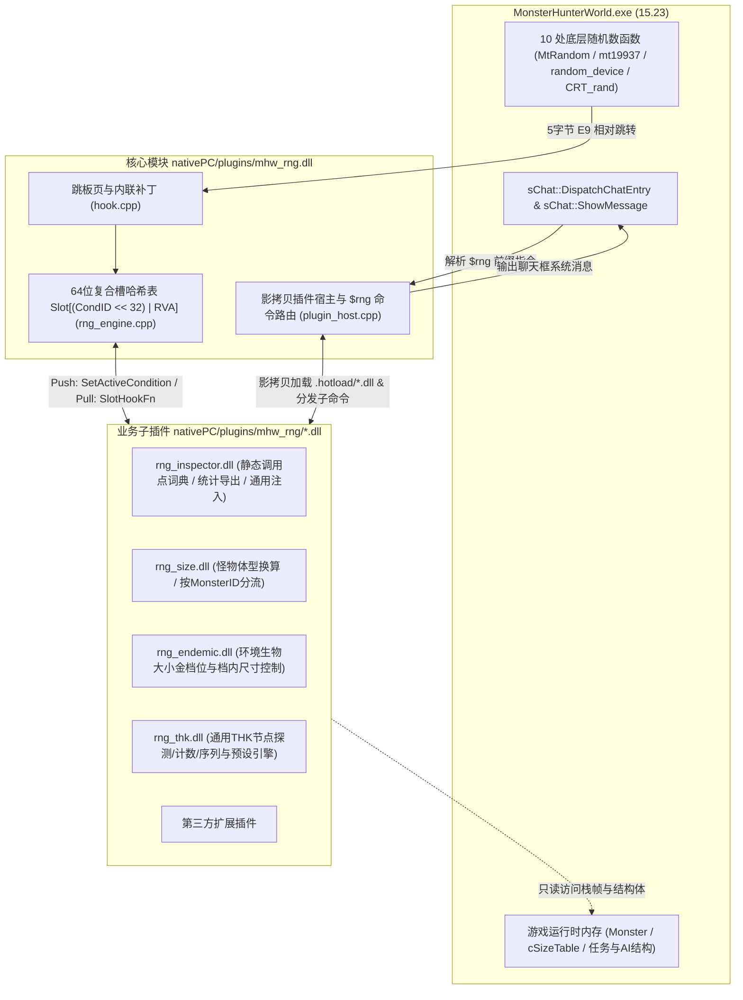
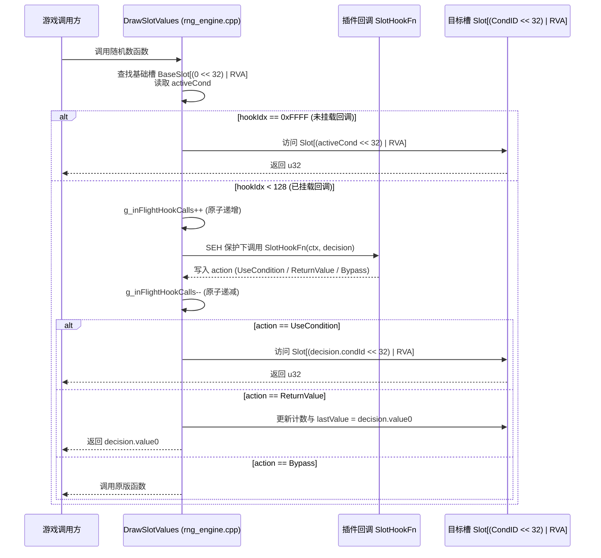

# `mhw_rng` 核心框架与插件 SDK（v2）技术文档

本文档说明 `mhw_rng` 随机数接管框架的职责划分、底层 Hook 点位、复合条件槽数据结构、条件分流机制、插件热重载流程以及插件 SDK 接口规范。目标客户端版本为《怪物猎人：世界 冰原》Steam 15.23（Build 15539686，默认镜像基址 `0x140000000`）。

> [!NOTE]
> **职责边界**
> 核心模块 [mhw_rng.dll](../src/dllmain.cpp) 仅负责底层随机数入口拦截、`(CondID, CallSiteRVA)` 槽位状态维护、插件生命周期管理与 `$rng` 聊天命令分发，不包含怪物 ID、数值换算公式或调用点词典等具体游戏业务逻辑。业务相关的内存读取、条件判断与命令扩展由 `nativePC\plugins\mhw_rng\*.dll` 下的子插件实现。

---

## 一、模块拓扑与目录结构



### 运行时文件与源码对照

| 组件 | 游戏目录部署路径 | 对应源码 | 说明 |
| :--- | :--- | :--- | :--- |
| 核心模块 | `nativePC\plugins\mhw_rng.dll` | [dllmain.cpp](../src/dllmain.cpp)、[rng_engine.cpp](../src/rng_engine.cpp)、[plugin_host.cpp](../src/plugin_host.cpp)、[hook.cpp](../src/hook.cpp) | 底层 Hook、复合槽表、插件宿主、基础 `$rng` 命令 |
| 配置文件 | `nativePC\plugins\mhw_rng.ini` | [mhw_rng.ini](../mhw_rng.ini)、[log_config.cpp](../src/log_config.cpp) | 启动开关、初始 `MasterSeed`、自动加载插件开关、按地址配置的 `[SlotOverrides]` |
| 热加载缓存目录 | `nativePC\plugins\mhw_rng\.hotload\` | [plugin_host.cpp](../src/plugin_host.cpp#L230-L250) | 运行时自动创建的隐藏目录，存放影拷贝后的临时 DLL |
| 插件 SDK 头文件 | *(仅编译期依赖，无需链接 `.lib`)* | [mhw_rng_api.h](../include/mhw_rng_api.h) | C ABI 数据结构、`MhwRngHostApi` 函数指针表与导出约定 |
| 官方插件：`inspector` | `nativePC\plugins\mhw_rng\rng_inspector.dll` | [inspector_plugin.cpp](https://github.com/Miraboreasyu/mhw-rng-inspector/blob/main/inspector_plugin.cpp) | 详见《`rng_inspector` 插件技术文档》([README.md](https://github.com/Miraboreasyu/mhw-rng-inspector/blob/main/README.md)) |
| 官方插件：`size` | `nativePC\plugins\mhw_rng\rng_size.dll` | [size_plugin.cpp](https://github.com/Miraboreasyu/mhw-rng-size/blob/main/size_plugin.cpp) | 详见《`rng_size` 插件技术文档》([README.md](https://github.com/Miraboreasyu/mhw-rng-size/blob/main/README.md)) |
| 官方插件：`endemic` | `nativePC\plugins\mhw_rng\rng_endemic.dll` | [endemic_plugin.cpp](https://github.com/Miraboreasyu/mhw-rng-endemic/blob/main/endemic_plugin.cpp) | 详见《`rng_endemic` 插件技术文档》([README.md](https://github.com/Miraboreasyu/mhw-rng-endemic/blob/main/README.md)) |
| 官方插件：`thk` | `nativePC\plugins\mhw_rng\rng_thk.dll` + `thk_presets\*.txt` | [thk_plugin.cpp](https://github.com/Miraboreasyu/mhw-rng-thk/blob/main/thk_plugin.cpp) | 详见《`rng_thk` 插件技术文档》([README.md](https://github.com/Miraboreasyu/mhw-rng-thk/blob/main/README.md)) |

---

## 二、底层随机数函数拦截

### 1. 拦截入口列表
对 15.23 版本 `.text` 段（48.3 MB）的静态分析表明，游戏内不存在内联展开的 Xorshift128 步进代码，也不包含 `rdrand` / `rdseed` 指令。全部伪随机数生成汇聚于以下 10 个函数入口（定义见 [mhw_addresses.h](../src/mhw_addresses.h)）：

| 序号 | RVA | 符号 / 用途 | 备份指令长度 | 接管行为 |
| :-: | :--- | :--- | :-: | :--- |
| 1 | `0x2174E30` | `MtRandom::nrand(this)` | 6 B | 主抽取入口（共 747 个外层调用函数），区分全局单例 `sInstance`（`0x143FDEBD8`）与局部实例 |
| 2 | `0x2174CE0` | `MtRandom::ctor(this, seed)` | 6 B | 接管私有 `MtRandom` 实例的带种子初始化 |
| 3 | `0x2174D50` | `MtRandom::ctor_default(this)` | 8 B | 接管私有 `MtRandom` 实例的默认构造 |
| 4 | `0x2174DC0` | `MtRandom::srand(this, seed)` | 6 B | 接管状态重置；忽略外部对全局 `sInstance` 的重设请求 |
| 5 | `0x2174E60` | `MtRandom::randUnitSphere(this, out3)` | 6 B | 从当前槽位连续抽取 2 个 `uint32_t`，按原版浮点系数生成单位球面三维向量 |
| 6 | `0x273D420` | `std::_Random_device()` | 9 B | 接管 `rand_s` 外部熵调用（用于集会区域列表随机排序等） |
| 7 | `0x27D3E60` | `mt19937_envelope_range` | 13 B | 接管线程局部 `mt19937` 的区间浮点数生成 |
| 8 | `0x2A74400` | `mt19937_heap_init` | 5 B | 替换 `time64 ^ clock` 初始种子为槽位派生值 |
| 9 | `0x2A744B0` | `mt19937_heap_draw` | 6 B | 接管堆上 `mt19937` 实例的整数抽取 |
| 10 | `0x2C58034` | `CRT_rand()` | 9 B | 接管 MSVC CRT `rand()`（备份头部 `+4` 处的 `E8 rel32` 由跳板重算相对偏移） |

### 2. 调用点 RVA 归一化规则
- **薄包装函数展开**：在 `ComputeCallSiteRva`（[rng_engine.cpp](../src/rng_engine.cpp#L215-L235)）中，若直接返回地址落在引擎的 4 个固定栈帧（`0x28` 字节栈空间 + `8` 字节返回地址 = `6` 个 QWORD）薄包装函数内（`0x04F71BF` `MtRandom::between`、`0x2396F02` / `0x2396F2D`、`0x197D6A2` / `0x197D6B5`），则自动向上读取 `slotPtr[6]` 作为调用点 RVA，使不同调用方拥有各自独立的槽位。
- **`CALL` 指令地址对齐**：`NormalizeUserSiteAddress`（[rng_engine.cpp](../src/rng_engine.cpp#L540-L578)）支持直接传入虚拟地址或 RVA；若传入地址处是目标为上述 10 个入口之一的 5 字节 `E8 rel32` 指令，则自动 `+5` 转换为对应的返回地址 RVA。
- **局部 `MtRandom` 实例跟踪**：对于先构造局部 `MtRandom` 再多次调用 `nrand(&local)` 的代码路径，内核使用 64 项环形数组 `g_overriddenInstances` 记录本轮（`Epoch`）内显式指定过构造种子的实例地址。若构造点被设了固定值/自定义种子而后续 `nrand` 点保持默认模式，则 `nrand(&local)` 按该局部实例自身的 `state[4]` 自然递推；否则由 `nrand` 调用点槽位直接给出返回值并更新 `self[0..3]`。

### 3. 跳板内存权限与链式 Hook
[hook.cpp](../src/hook.cpp) 在主程序镜像 `±2 GB` 范围内申请一页 4 KB 跳板内存：
1. `PrepareDetour` 在 `PAGE_READWRITE` 权限下生成原始头部指令跳板与 14 字节绝对跳转中继；若目标函数入口首字节已经是 `0xE9`（已被其它插件如 `mhw_hfi.dll` 先行挂钩），则解析既有跳转目标并串联为原函数入口，避免互相覆盖。
2. `SealAndActivateAll` 先将跳板页权限改为 `PAGE_EXECUTE_READ`（不可写可执行）并调用 `FlushInstructionCache`，随后将 5 字节 `E9 rel32` 写入各目标入口（对 8 字节对齐地址使用 `_InterlockedCompareExchange64` 原子替换）。

---

## 三、64 位复合条件槽表 `Slot[(CondID << 32) | RVA]`

### 1. 按调用点与条件拆分子流的原因
原版游戏中，粒子特效、环境生物、UI 抖动、怪物 AI 与体型抽取共用同一个全局 `MtRandom::sInstance`，并由多个工作线程并发调用。帧率变化或额外特效都会改变 `sInstance` 的推进次数，导致固定全局种子无法稳定复现行为。

微内核在静态存储区维护一张容量为 **8,192 项**的开放寻址哈希表 `g_slots`（[rng_engine.cpp](../src/rng_engine.cpp#L97-L154)）：
- **复合键格式**：
  $$\text{CompositeKey} = (\text{uint64\_t}(\text{condId}) \ll 32) \mid \text{uint64\_t}(\text{callSiteRva})$$
  `condId == 0` 为基础槽；当插件定义条件编号 `condId > 0` 时，同一 `callSiteRva` 在不同条件下对应不同的 `RngSlot` 实例。
- **内存开销**：单个 `RngSlot` 按 64 字节缓存行对齐（实际大小 128 字节），8,192 项固定占用 1 MB 静态未初始化段（BSS），外加 256 KB 静态长序列池 `g_seqPool`，运行时无动态堆分配。
- **子流初始化与推进**：当槽位记录的 `seededEpoch` 与全局 `g_seedEpoch` 不一致时，使用 `SplitMix64` 将 `(Seed, RVA, CondID)` 混合生成非全零的 128 位初始状态 `state[0..3]`，之后每次抽取调用与原版一致的 `StepMhwXorshift128` 推进。不同调用点或不同 `CondID` 之间互不影响推进次数。
- **并发与轮次重置**：槽位认领通过原子 `compare_exchange_strong` 完成且运行期不删除键；单个槽位的状态读写由 `std::atomic_flag` 自旋锁保护。调用 `ResetEpoch()` 只需原子递增 `g_seedEpoch`，各槽位在下次被访问时自动按新轮次重新派生初始状态并归零序列游标。

### 2. 槽位工作模式（`MhwRngSlotMode`）

| 枚举值 | 名称 | 行为说明 |
| :-: | :--- | :--- |
| `0` | `kMhwRngSlotMasterDerived` | 默认模式，由 `(MasterSeed, RVA, CondID)` 派生确定性子流 |
| `1` | `kMhwRngSlotCustomSeed` | 独立种子模式，由 `(customSeed, RVA, CondID)` 派生子流，不受全局 `MasterSeed` 修改影响 |
| `2` | `kMhwRngSlotFixedValue` | 固定值模式，每次恒定返回 `fixedValue`（原始 `uint32_t`） |
| `3` | `kMhwRngSlotSequence` | 序列模式，按顺序输出预设数组（长度 `<= 8` 存于槽内 `inlineSeq`，`> 8` 存于 `g_seqPool`），支持 `Loop`（循环）、`HoldLast`（停在末项）、`FallbackDerived`（播完转确定性子流） |
| `4` | `kMhwRngSlotBypass` | 原版直通模式，跳过接管，调用原版跳板函数 |

---

## 四、条件分流机制：Push 模式与 Pull 同步回调

微内核提供两种方式在运行时改变某个 `RVA` 使用的条件或返回值：



1. **Push 模式（`SetActiveCondition`）**：
   插件在外部时机修改基础槽的原子字段 `activeCond`。抽签路径无需进入函数回调，适合随任务状态或配置切换的全局条件。
2. **Pull 模式（`RegisterSlotHook`）**：
   插件在特定 `RVA` 的基础槽上挂载同步回调函数 `MhwRngSlotHookFn`。当同一帧内多个实体在不同线程调用同一 `RVA`（如多只怪物同时生成或决策 AI）时，回调可通过 `MhwRngDrawContext` 中的 `returnAddrSlot`（栈上返回地址位置）和 `rngInstance` 识别当前调用方实体，并选择：
   - `kMhwRngActionUseCondition`：将本次抽取路由到指定的 `decision.condId` 复合槽；
   - `kMhwRngActionReturnValue`：直接返回现场计算的 `decision.value0`；若需要确定性随机数参与自定义分布计算，可调用上下文提供的 `ctx->DrawDeterministic(rva, condId)`；
   - `kMhwRngActionBypass`：仅本次调用走原版随机数函数。

未挂载回调的槽位 `hookIdx` 为 `0xFFFF`，抽签时仅做一次无符号比较，不进入回调逻辑。回调函数在槽位自旋锁外部执行，并由 `__try / __except` 捕获硬件异常（异常发生时回退至 `UseCondition(activeCondId)`）。

---

## 五、影拷贝热重载与锁层次设计

插件宿主实现位于 [plugin_host.cpp](../src/plugin_host.cpp)。

### 1. 影拷贝加载（Shadow-Copy）
Windows 的 `LoadLibrary` 会锁定磁盘上的目标 DLL 文件，导致游戏运行期间无法重新编译覆盖原文件。宿主在加载 `nativePC\plugins\mhw_rng\<name>.dll` 时，先将其复制为 `.hotload\<shortName>.<gen>.<pid>.dll` 再调用 `LoadLibraryA`。原目录下的 `.dll` 文件始终保持未锁定状态，可直接覆盖后通过聊天指令 `$rng reload <shortName>` 重新加载。

### 2. 两级锁与卸载静默等待
为避免热重载等待与插件回调产生锁顺序死锁，宿主将互斥锁拆分为两级：
- **`g_lifecycleMx`（生命周期递归锁）**：串行化插件的加载、卸载、整体重载与聊天子命令执行（防止子命令执行中途插件被卸载）。
- **`g_registryMx`（注册表叶子锁）**：仅保护内存中的插件列表、子命令表、RVA 元数据表与兜底解析器列表，不在调用插件函数、`LoadLibrary`/`FreeLibrary` 或等待回调排空期间持有。插件短名称另存于静态定长数组 `g_shortNameCache`，使 `GetPluginShortName` 可无锁返回稳定指针。

卸载或重载单个插件（`UnloadByIdLifecycleLocked`）按以下四步执行：
1. **摘除回调并等待在途调用结束**：调用 `rng::DetachAllHooksForPluginAndWait(id)`，将插件关联的 `baseSlot->hookIdx` 置为无效、槽钩子项 `active` 置为 `false`，随后轮询等待原子计数 `g_inFlightHookCalls == 0`，确保没有工作线程仍在该插件代码段中执行。
2. **清理注册项与槽位规则**：移除 `ownerId == id` 的所有聊天子命令、站点元数据与兜底解析器，并将该插件名下的复合槽重置为 `MasterDerived`。
3. **停机通知**：在 SEH 保护下调用插件导出的 `MhwRngPlugin_Shutdown()`。
4. **释放模块**：调用 `FreeLibrary` 卸载影子 DLL，并尝试删除对应的 `.hotload\*.dll` 临时文件。

---

## 六、插件开发接口规范（Plugin SDK v2）

子插件只需包含单一头文件 [mhw_rng_api.h](../include/mhw_rng_api.h)，无需链接任何导入库。

### 1. 必选与可选导出函数
每个子插件 DLL 需以 C 链接约定导出以下函数：
- `const MhwRngPluginDescriptor* MhwRngPlugin_GetInfo()`：返回插件元数据，其中 `targetApiVersion` 必须等于 `kMhwRngApiVersion`（当前为 `2`），`shortName` 为全小写唯一标识（用于 `$rng reload <shortName>`）。
- `bool MhwRngPlugin_Init(const MhwRngHostApi* host, MhwRngPluginId selfId)`：插件初始化入口，保存 `host` 与 `selfId` 并注册子命令、元数据或槽位回调；返回 `false` 表示初始化失败，宿主会自动回滚并卸载。
- `void MhwRngPlugin_Shutdown()`（可选）：卸载前通知入口。宿主调用此函数前已完成回调摘除、并发等待与规则清理。

### 2. `MhwRngHostApi` 主要接口分类

| 类别 | 接口函数 | 用途说明 |
| :--- | :--- | :--- |
| 路径与输出 | `GetRootPluginDir` / `GetSubPluginDir` | 获取 `nativePC\plugins` 与 `nativePC\plugins\mhw_rng` 路径 |
| 路径与输出 | `ChatPrint` / `ChatPrintf` / `Log` | 向游戏聊天框输出 UTF-8 消息，或写入 `mhw_rng.log` |
| 全局控制 | `SetTakeoverEnabled` / `SetMasterSeed` / `ResetEpoch` | 开关接管、修改 64 位总种子、重置全局轮次 |
| 地址辅助 | `NormalizeSiteAddress` | 将虚拟地址或 `CALL` 指令地址归一化为返回地址 RVA |
| 条件与槽规则 | `SetActiveCondition` / `GetActiveCondition` | 读写指定 RVA 基础槽的 Push 模式活动条件号 |
| 条件与槽规则 | `SetCondMasterDerived` / `SetCondCustomSeed` / `SetCondFixedValue` / `SetCondSequence` / `SetCondBypass` | 设置指定 `(rva, condId)` 复合槽的工作模式与参数 |
| 条件与槽规则 | `ClearSlotAllConditions` / `ClearPluginRules` / `ClearAllRules` | 清理单个 RVA 全部条件槽、当前插件名下规则或全局规则 |
| 同步回调 | `RegisterSlotHook` / `UnregisterSlotHook` | 在指定 RVA 上注册或移除 Pull 模式同步决策回调 |
| 命令与元数据 | `RegisterSubcommand` | 注册 `$rng <subcmd>`（同时兼容 `$rng_<subcmd>`）子命令处理器 |
| 命令与元数据 | `RegisterSiteMeta` / `SetFallbackMetaResolver` / `QuerySiteMeta` / `FormatSlotCustom` | 注册站点别名、中文描述、状态格式化回调或全局词典解析器 |
| 状态快照 | `GetCondSlotInfo` / `GetActiveSlotCount` / `SnapshotActiveSlots` | 读取单个或全部已激活复合槽的计数与当前状态 |

### 3. 插件线程安全与编写约束
1. **锁顺序要求**：插件内部若使用互斥锁保护自有状态，应将其视为纯叶子锁，**不要在持有插件内部互斥锁的同时调用 `host->...` 接口**。原因在于宿主执行 `FormatSlotCustom` 等查询时可能从外部调用插件回调，若插件持锁反向调用宿主或槽位接口，容易引入锁顺序反转。
2. **回调执行环境**：`MhwRngSlotHookFn` 会被任意调用随机数的游戏工作线程并发触发。回调内应避免阻塞操作和动态内存分配；访问游戏栈帧或对象指针时需先校验地址处于合法用户态区间（如 `0x100000 .. 0x7FFFFFFF0000`）并使用 `__try / __except` 隔离潜在的无效指针读取。
3. **浮点消费点边界**：原版多处权重表采用 `(float)nrand() * (100.0f / 2^32) <= (float)cumWeight` 判定。若需映射 `[0%, 100%]` 区间，建议将 `uint32_t` 限制在 `[0x00000001U, 0xFFFFFF00U]`，避免 `0U` 命中 `weight == 0` 的前导禁用行，也避免 `0xFFFFFFFFU` 舍入为 `100.0f` 超出表总权重。

### 4. 最小插件示例

```cpp
#include "mhw_rng_api.h"

namespace {
const MhwRngHostApi* g_host   = nullptr;
MhwRngPluginId       g_selfId = 0;

// 猫饭技能发动判定调用点 (u32 % 100)
constexpr std::uint32_t kRvaMealTrigger = 0x0F99246U;

void __fastcall Cmd_Meal(int argc, const char* const* argv, const char*, void*) {
    if (argc >= 1 && argv[0][0] == '0') {
        g_host->ClearSlotAllConditions(kRvaMealTrigger);
        g_host->ChatPrint(u8"[meal] 已恢复正常猫饭发动概率");
        return;
    }
    g_host->SetCondFixedValue(g_selfId, kRvaMealTrigger, 0U, 0U);
    g_host->ChatPrint(u8"[meal] 已固定猫饭技能判定余数为 0");
}

const MhwRngPluginDescriptor kDesc = {
    kMhwRngApiVersion,
    "meal",
    u8"猫饭技能判定示例插件",
    "1.0.0",
    u8"固定猫饭技能发动判定结果"
};
} // namespace

MHW_RNG_PLUGIN_EXPORT const MhwRngPluginDescriptor* MhwRngPlugin_GetInfo() {
    return &kDesc;
}

MHW_RNG_PLUGIN_EXPORT bool MhwRngPlugin_Init(const MhwRngHostApi* host, MhwRngPluginId selfId) {
    if (!host || host->apiVersion != kMhwRngApiVersion) return false;
    g_host   = host;
    g_selfId = selfId;

    host->RegisterSiteMeta(selfId, kRvaMealTrigger, "meal.trigger", u8"猫饭技能发动判定", nullptr, nullptr);
    host->RegisterSubcommand(selfId, "meal", "$rng meal [1|0]", u8"设置或清除猫饭技能固定发动", &Cmd_Meal, nullptr);
    return true;
}

MHW_RNG_PLUGIN_EXPORT void MhwRngPlugin_Shutdown() {
    g_host   = nullptr;
    g_selfId = 0;
}
```

编译与热加载命令：
```bat
cl.exe /nologo /std:c++17 /O2 /EHsc /MT /utf-8 /I "include" rng_meal.cpp /LD /Fe:"...\nativePC\plugins\mhw_rng\rng_meal.dll"
```
在游戏聊天框输入 `$rng load meal` 即可首次加载；后续修改源码重编覆盖后，输入 `$rng reload meal` 更新。

---

## 七、核心内置命令与构建测试

### 1. 微内核内置聊天命令
所有核心命令与插件命令共用 `mhw_rng.ini` 中配置的 `ChatPrefix`（默认 `$rng`，支持空格 `$rng <subcmd>` 或下划线 `$rng_<subcmd>`）：
- `$rng` / `$rng status`：查看接管状态、当前总种子、轮次、活跃槽数、已加载插件数与前几条激活规则。
- `$rng help`：列出核心命令与当前已注册的所有插件子命令名。
- `$rng plugins` / `load <name>` / `unload <name>` / `reload [name]`：查询、加载、卸载或热重载子插件（不带参数的 `reload` 会同时重读 `mhw_rng.ini` 并重载全部插件）。
- `$rng on` / `off` / `seed <u64>` / `reset` / `clearall`：全局接管开关、修改总种子、递增轮次、清空所有槽覆盖规则。
- `$rng rawfix` / `rawseed` / `rawbypass` / `rawclear`：在不加载任何插件的情况下直接按数值 RVA 操作指定槽位。

### 2. 构建与脱机回归测试
- 运行 [build.bat](../build.bat)：使用 MSVC x64 编译产出 `build\mhw_rng.dll`、`build\mhw_rng\rng_inspector.dll`、`build\mhw_rng\rng_size.dll`、`build\mhw_rng\rng_endemic.dll`、`build\mhw_rng\rng_thk.dll` 及 `build\mhw_rng\thk_presets\fatalis_p1_nasty.txt`。
- 运行 [run_tests.bat](../run_tests.bat)（测试源码：[test_rng_harness.cpp](../tests/test_rng_harness.cpp)）：在测试进程中加载 `text_1523.bin`，安装全部 10 处 Hook，验证 8 线程并发流隔离、`Epoch` 重置、复合条件槽分流、真实 `cSizeTable::getSizeMultiplier` 机器码下的按怪体型分流与零权重行跳过、真实环境生物尺寸函数（`0x141669AC0` / `0x14166CCC0` / `0x140672F90`）下的大小金与共享调用方隔离、真实 THK 虚拟机（`0x14132B838` / `0x14133A850` -> `0x141339640`）下的通用节点探测/计数/有序序列/外部预设加载与黑龙一阶段二足纯 RNG 控招、以及影拷贝热重载时源 DLL 的可写状态。
